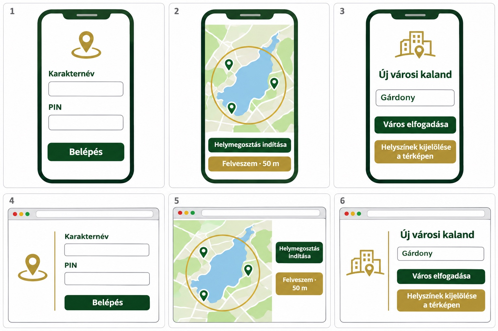
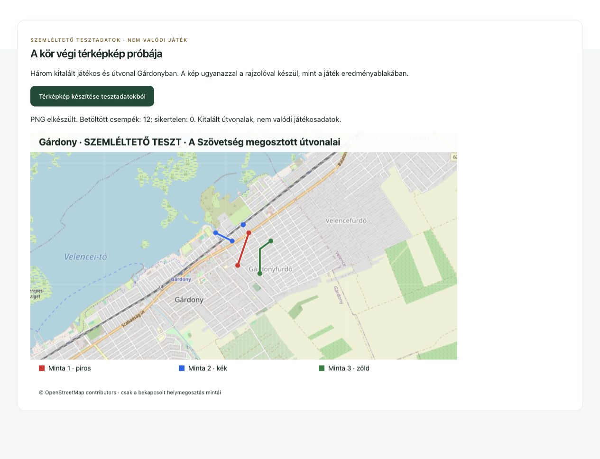

# Felhasználói kézikönyv

## Tartalomjegyzék

- [Sauron aktuális helyének láthatósága](#sauron-aktuális-helyének-láthatósága)

- [Adminisztrátori kézi leállítás](#adminisztrátori-kézi-leállítás)

- [Aktuális webes és natív állapot](#aktuális-webes-és-natív-állapot)
- [Belépés utáni összesítő javítása](#belépés-utáni-összesítő-javítása)
- [Natív alkalmazás és tartós rablásjelzés](#natív-alkalmazás-és-tartós-rablásjelzés)
- [Gyűrűidő, szín és a kör végi térképkép](#gyűrűidő,-szín-és-a-kör-végi-térképkép)
- [Helyszínalapú random pálya](#helyszínalapú-random-pálya)
- [Megjelenítés, menü és random elhelyezés](#megjelenítés,-menü-és-random-elhelyezés)
- [Telepítés Androidra és iPhone-ra](#telepítés-androidra-és-iphone-ra)
- [Verziókövetés](#verziókövetés)
- [Mobilos és asztali webes nézet](#mobilos-és-asztali-webes-nézet)
- [Belépés és karakter](#belépés-és-karakter)
- [Játékos lépései](#játékos-lépései)
- [Admin lépései](#admin-lépései)
- [Hibaelhárítás](#hibaelhárítás)

## Verziókövetés

| Dokumentum | Játékverzió | Dátum | Változás |
| --- | --- | --- | --- |
| 1.0 | 1.5.3 | 2026-11-16 | Első kiadás a jelenlegi játékhoz. |
| 1.1 | 1.5.3 | 2026-11-16 | Mobilos és asztali webes útmutató képi illusztrációval. |
| 1.2 | 1.5.3 | 2026-11-16 | Áttekintve a technológiai leltár dokumentálásakor. |
| 1.3 | 1.5.3 | 2026-11-16 | Áttekintve a regressziós jegyzőkönyvezés bevezetésekor. |
| 1.4 | 1.6.0 | 2026-11-20 | Telepíthető mobilváltozat, használat, működés és korlátok dokumentálása. |
| 1.5 | 1.7.0 | 2026-11-20 | Belépett menü, világos/sötét megjelenítés és véletlen pályaterv. |
| 1.6 | 1.7.1 | 2026-11-20 | 1/3/5 km választó; gyűrűk és Mordor éttermeknél, kocsmáknál vagy nevezetességeknél. |
| 1.7 | 1.8.0 | 2026-11-21 | Gyűrűnkénti 60 perc, hat gyűrűs lezárás, színek, ikonbeállítás és körkép. |
| 1.8 | 1.8.0 | 2026-11-21 | Közös ötperces helymegosztás kiszabadítja Sauron gyűrűit. |
| 1.9 | 1.8.0 | 2026-11-21 | Telefonos sáv a Beállításokban és a térképoldal alján. |
| 1.10 | 1.8.0 | 2026-11-21 | Teljes szélességű, nagy helymegosztási gombok. |
| 1.11 | 1.8.0 | 2026-11-21 | Android/iPhone natív háttér-GPS igény rögzítve; a PWA korlátja változatlan, külön fejlesztés indul. |
| 1.12 | 1.9.0 | 2026-11-21 | Tartós, nyugtázható piros rablásjelzés és címzettvédett Realtime. |
| 1.13 | 1.9.0 | 2026-11-21 | Android/iPhone natív projektek, háttér-GPS és biztonságos munkamenethíd. |
| 1.14 | 1.9.1 | 2026-11-21 | Natív appkészítés elhalasztva, kód és eredmények megőrizve; automatikus fordítás kikapcsolva. |
| 1.15 | 1.9.1 | 2026-11-21 | Böngészős automatikus megosztásfolytatás kérése visszavonva; marad a kézi újraindítás. |
| 1.16 | 1.9.2 | 2026-11-21 | A felhasználó jóváhagyta a natív app folytatását; böngészős kézi GPS működés megmarad. |
| 1.17 | 1.9.3 | 2026-11-21 | Történeti popup tiltása belépéskor, körhöz kötött térkép; natív sikeres build és korlátok ellenőrizve. |
| 1.18 | 1.9.4 | 2026-11-21 | Admin kézi megszakítás visszaállítva, jogosultság és megerősítés tesztelve; az 1.9.3 élesítése igazolt. |
| 1.19 | 1.9.5 | 2026-11-21 | Sauron élő helye csak saját gyűrűvel és friss saját helymegosztással látható; szerverválasz és kliens ellenőrizve. |

## Mobilos és asztali webes nézet

Az ábra felső sora a mobilos, az alsó az asztali webes használatot szemlélteti. Balról jobbra a belépés, a térképes játék és a városbeállítás látható. A gombok helye az ábrán és a tényleges felületen eltérhet.

| Művelet | Mobilböngésző | Asztali böngésző |
| --- | --- | --- |
| Belépés | Nyisd meg a **Belépés** menüt, majd görgess a megfelelő űrlaphoz. | Nyisd meg a **Belépés** menüt, és válaszd a visszatérő vagy az új karakter űrlapját. |
| Térkép | Húzd ujjal a térképet, nagyíts két ujjal vagy a + gombbal. A térkép alá görgetve éred el a helymegosztást és a kincsek listáját. | Húzd egérrel a térképet, használj görgőt vagy +/− gombot. A helymegosztás széles nézetben a térkép mellett található. |
| Helymegosztás | Aktív körben indítsd el a megosztást, és engedélyezd a helyhozzáférést a böngészőben. Terepen a telefont használd a gyűrű felvételéhez. | Ugyanazzal a gombbal indítható. A helymeghatározás pontossága az eszköztől függ, ezért a térkép és a kezelőfelület asztalon akkor is használható áttekintésre, ha a GPS pontatlan. |
| Adminisztráció | Ha az **Admin** menü kívül esik a képernyőn, görgesd oldalra a menüsort. A helyszínt érintéssel jelöld ki. | Az **Admin** menüben fogadd el a várost, majd a szerkesztőben egérkattintással helyezd el a pontokat. |

## Belépés és karakter

Nyisd meg a [játékot](https://ngynrbrt-prog.github.io/szuper-titkos-szovetseg/?v=1.8.0). Az **Új karakter** űrlapon válassz nevet, 6–12 számjegyes PIN-t, fajt és fegyvert. A **Visszatérő vándor** űrlapon lépsz be. A térképes ikont a **Beállítások → Térképes karakterikon → Ikon mentése** útvonalon állíthatod át.

## Játékos lépései

1. Aktív körben nyisd meg a **Térkép** oldalt, és indítsd el a helymegosztást. A friss, megosztott helyeket karakterikonok jelölik.
2. Az arany keresőkör segít megtalálni a gyűrűt. Saját gyűrűvel és aktív megosztással megjelenik a pontos jelölő.
3. Menj a tárgy tényleges helyétől 50 méteren belülre, majd válaszd a **Felveszem · 50 m** gombot. A műveletet a térképi jelölő felugró ablakából indítsd; belépett nézetben nincs külön kincslista.
4. A **Szövetség** oldalon választhatsz rablást, ha mindkét játékos megosztja friss helyét és 100 méteren belül vannak egymáshoz. A páros rablási védelem 15 perc.
5. A **Hátizsákban** legalább 60 perc gyűrűnkénti igazolt helymegosztás után, Mordor 50 méteres körzetében semmisítheted meg a saját gyűrűdet. Több gyűrűnél elérhető az együttes megsemmisítés is. A kör a hatodik gyűrű megsemmisülésekor ér véget, ekkor jelenik meg az eredményablak. Az **Eredmények** oldalon a pontok és a korábbi körök is láthatók.

## Admin lépései

1. **Admin → Új városi kaland** alatt írd be a települést, például Gárdonyt, majd nyomd meg a **Város elfogadása** gombot. Több találat esetén válassz a listából. Korábbi helyszínek esetén a váltás megerősítést kér.
2. **Helyszínek kijelölése a térképen** alatt válaszd ki a hat gyűrű helyét név szerint, Mordort és Sauron útvonalát. A pontok a központ 10 km-es körzetébe kerüljenek. Külön drágakőhelyeket is megadhatsz.
3. Ellenőrizd a helyek és az útvonal gyalogos megközelíthetőségét, jelöld be a jóváhagyást, majd válaszd az **Előkészített játék létrehozása** és a **Játék indítása** gombot.
4. Az aktuális kör még földön lévő gyűrűit a **Gyűrűk helyének módosítása** gombbal mozgathatod. Jelölj ki új pontot, hagyd jóvá és mentsd. Új körhöz térj vissza az új játék űrlapjához.

## Hibaelhárítás

Ha a gyűrűfelvétel sikertelen, ellenőrizd, hogy aktív-e a kör, engedélyezett-e a helymegosztás, elég friss-e a GPS és a gyűrű még a földön van-e. Ha az új funkció hiányzik, frissítsd az oldalt a kiadási hivatkozásról. Az éles változat azonosítója a [kiadási dokumentumban](RELEASE-ELESITES.md) található.

## Telepítés Androidra és iPhone-ra

1. Nyisd meg a játékot a telefon böngészőjében, majd válaszd a **Telepítés a telefonra** gombot.
2. **Android / Chrome:** ha megjelenik, fogadd el a telepítést; egyébként a böngésző menüjében válaszd az **Alkalmazás telepítése** vagy **Hozzáadás a kezdőképernyőhöz** pontot.
3. **iPhone / Safari:** **Megosztás → Főképernyőhöz adás → Hozzáadás**. Ha megjelenik a **Megnyitás webalkalmazásként**, legyen bekapcsolva.
4. Indítsd a zöld, arany gyűrűs ikonról. A telepített alkalmazás külön bejelentkezést és helyengedélyt kérhet. A helymegosztást indítsd újra.
5. Az **Új verzió elérhető** gombbal frissíthetsz. Ez újratölti a felületet és megszakítja a helymegosztást, ezért utána ellenőrizd és indítsd újra.

A játékhoz internet szükséges. Kapcsolatvesztéskor figyelmeztetés jelenik meg, offline indításkor pedig újrapróbálási oldal. Tartsd az alkalmazást előtérben és a kijelzőt bekapcsolva a helymegosztáshoz. Törlés: a telefonon hosszan nyomd az ikont, majd válaszd az eltávolítást. A böngésző és az alkalmazás adatai külön is megmaradhatnak.

## Megjelenítés, menü és random elhelyezés

Belépés után a fejlécben **Belépve: karakternév** látszik a **Kilépés** előtt. A Belépés gomb eltűnik. A **Beállítások → Megjelenítés** alatt válassz **Világos** vagy **Sötét** módot, majd **Beállítás mentése**. A választás ezen az eszközön, karakterenként mentődik; másik telefonon külön állítható. Az **Admin** menüpont kizárólag a belépett admin számára látszik.

A térképi tárgyjelölőre vagy gyűrű-keresési jelölőre bökve nyisd meg a felvételi műveletet. Belépve nincs külön „A következő felfedezés” tárgylista. A szükséges távolság, friss GPS és aktív játék továbbra is feltétel.

**Véletlen pálya:**

1. Admin → Új városi kaland: fogadd el a várost, majd nyisd meg a térképes szerkesztőt.
2. Válassz **1 km**, **3 km** vagy **5 km** sugarat a listából; alapérték 1 km.
3. Nyomd meg a **Random elhelyezés** gombot, majd bökj a kívánt középpontra. A gomb ismételt megnyomásával megszakíthatod a módot. A teljes kör maradjon a városközpont 10 km-es körzetében.
4. Korábbi tervnél erősítsd meg a lecserélést. 6 gyűrű, 20 drágakő, Mordor és Sauron útvonala jelenik meg. A jelenlegi játékot ez még nem változtatja meg.
5. Vizsgáld át az összes pontot és útvonalszakaszt. Húzással módosíthatod a jelölőket; a véletlen útvonal nem követi automatikusan az utcákat. Vízre, magánterületre vagy veszélyes helyre eső pontot helyezz át.
6. Jóváhagyás után hozd létre az előkészített játékot, és csak ellenőrzés után indítsd el. Kézi tervnél a korábbi 40 drágakő az alapérték; generált tervnél 20.

## Helyszínalapú random pálya

A **Random elhelyezés** mellett a lenyíló listában **1 km**, **3 km** vagy **5 km** választható. Térképkattintás után várd meg az éttermek, kocsmák és nevezetességek keresését. A hat gyűrű és Mordor az ilyen helyekre kerül; a nevük megjelenik a szerkesztőben. Kevés találatnál válassz nagyobb sugarat vagy másik középpontot. Hálózati hibánál próbáld később: a korábbi terv nem vész el.

A generált gyűrűt és Mordort ismert helyszín közelébe húzva vagy kattintva a jelölő a helyszín koordinátájára illeszkedik. 150 méteren belüli megfelelő hely hiányában az áthelyezés elutasított. Újratöltés után a hét kiválasztott hely marad ismert; más helyekhez új generálást indíthatsz. A térképes adatok lehetnek elavultak, a hely nyitvatartását, megközelíthetőségét és a teljes útvonalat indulás előtt ellenőrizd. A véletlenül generált drágakő és útvonalpont továbbra is kézzel áthelyezhető.

## Gyűrűidő, szín és a kör végi térképkép

**Beállítások:** itt találod a térképes karakterikon, az egyedi játékosszín és a világos/sötét megjelenítés választóját. Nyolc alapszín elérhető: piros, kék, zöld, sárga, narancs, lila, rózsaszín, barna. Foglalt szín nem választható; aktív játékban a színmező zárolt. A Szövetség névsorában a választott karakterikon és egy színjelzés látszik a név mellett.

**Hátizsák:** minden saját gyűrű mellett kis gyűrűkép, haladási sáv és „perc/mp / 60 perc” érték látható. Az idő csak a gyűrű birtoklása közbeni, friss bekapcsolt helymegosztásokból gyűlik. Szünetben nem halad, elvesztés vagy új tulajdonos után nulláról indul. 60 percig a megsemmisítés gomb tiltott; utána is Mordor 50 m-es körzete és friss GPS szükséges. Több gyűrű együttes megsemmisítéséhez mindegyik saját gyűrűnek külön teljesítenie kell az egy órát.

Az aktív játék csak mind a hat gyűrű megsemmisülésekor ér véget; a pontszám alapján készül a rangsor. Sauron minden gyűrű megszerzésével sem fejezi be a kört. A még el nem indított játékot az admin az Előkészület elvetése gombbal törölheti az aktív előkészületek közül.

**Közös kiszabadítás:** ha Sauronnál van gyűrű, minden regisztrált játékosnak egyszerre kell helyet megosztania öt percen át, új elfogás nélkül. A térkép melletti helymegosztási kártya mutatja az X/Y játékost és a közös időt. Leállítás, 30 másodpercnél régebbi GPS vagy új elfogás újrakezdi az öt percet. Siker esetén Sauron összes gyűrűje visszakerül eredeti helyére, ismét felvehető, és az új birtokos egyórás számlálója nulláról indul.

**Kör végi térképkép:** az eredményablakban megjelenik a kiválasztott város és a kör alatt megosztott, játékosszínű útvonalak képe. A Térképkép mentése link PNG-ként letölti. A megosztási szüneteket nem köti össze a vonal. Előfordulhat hiányos háttértérkép; ilyenkor az Újrapróbálás gombbal kérheted újra. A PNG nincs a szerverre vagy GitHubra feltöltve.

**Helyadatok:** az aktív körben bekapcsolt megosztásból útvonalminták tárolódnak, hogy a lezáráskor minden regisztrált játékos lássa a térképet. 30 nap után már nem érhetők el; a lejárt minták törlése a következő játékkéréskor történik. Korábbi, még nem rögzített köröknél nincs visszamenőleges útvonal.

**Telefonos sáv és nagy gombok:** a Szövetség a telefonodon sáv a Beállításokban és a kezdő Térkép oldal legalján található. Más oldalon nem jelenik meg. A Helymegosztás indítása és Megosztás leállítása teljes kártyaszélességű, nagy gomb; mobilon a térkép alatt helyezkedik el.

A lezárt képernyős, bezárt oldalas folyamatos GPS Androidon és iPhone-on külön natív alkalmazást igényel. Az 1.8.0 webes változat ezt nem teljesíti, nem címkéz elavult helyadatot frissként. Források: [Android háttérhelymeghatározás](https://developer.android.com/develop/sensors-and-location/location/background), [Apple Core Location](https://developer.apple.com/documentation/corelocation/handling-location-updates-in-the-background).

## Natív alkalmazás és tartós rablásjelzés

Ha meglopnak, a kezdő térképoldal piros doboza kiírja: **Rablás történt**, valamint az elrabolt tárgy nevét és a rabló karakternevét. A doboz addig marad, amíg a saját fiókoddal meg nem nyomod a **Rendben** gombot. Újranyitás után is visszatér, ha még nem nyugtáztad. A valós idejű kapcsolat megszakadásánál a következő sikeres állapotlekérés hozza meg a jelzést.

A natív Android/iPhone app használatát és telepítését a [mobil útmutató](../mobile/README.md) írja le. Androidon pontos hely és állandó megosztási értesítés szükséges; a helymegosztás az értesítésből is leállítható. iPhone-on Mindig helyengedély szükséges; a rendszer engedélykérési lépései miatt ezt a telefon Beállításaiban is be kell kapcsolni, majd újra indítani a megosztást. A saját natív appban a Telefonra telepítés PWA-sáv nem jelenik meg, mert már telepített appot használsz.

A kijelző lezárása és az app háttérbe tétele mellett a natív helyszolgáltatás működhet tovább. Kényszerített leállítás, jogosultságvisszavonás, energiatakarékosság és GPS/hálózati hiány esetén ez megszakadhat. Csak a szerverhez érkezett friss, elfogadott mérés számít a gyűrű- és csapatidőbe. Normál böngészőben/PWA-ban továbbra is előtérben kell tartani az oldalt a megbízható GPS-hez.

## Aktuális webes és natív állapot

Az Android/iPhone fejlesztés a felhasználó jóváhagyása alapján folytatódott. A korábbi halasztás történeti döntés, nem jelenlegi korlátozás. Az Android 1.9.2 teszt-APK és az aláírás nélküli iOS-szimulátor build sikeres a [44842967106 futásban](https://github.com/ngynrbrt-prog/szuper-titkos-szovetseg/actions/runs/44842967106), forrás: `2dded917eb8561da9c27195eb1c7cbda439c2fdc`. Android build és lint sikeres; az első futás hibáját az AndroidX OnBackPressedDispatcher javította. [Android ZIP](https://github.com/ngynrbrt-prog/szuper-titkos-szovetseg/actions/runs/44842967106/artifacts/14681647800): kicsomagolás után az app-debug.apk telepíthető tesztelésre. Fizikai telefonos háttér-GPS még nem igazolt. Az iPhone valódi készülékes telepítéséhez aláírás szükséges; a felhasználónak nincs Apple-fejlesztői hozzáférése, aláírt iPhone-telepítő nincs.

A böngésző/PWA továbbra is használható; a natív híd normál böngészőben nem aktiválódik. Böngészős szünet után kézi helymegosztás-indítás szükséges, automatikus újraindítást a felhasználó nem kért. A szünet alatt nincs gyűrűidő-jóváírás.

## Belépés utáni összesítő javítása

Az 1.9.3 nem nyitja meg belépéskor egy korábban befejezett játék eredményablakát és térképét. Az aktív Gárdony-játék mellé így nem kerül a régi prágai kör képe. Az összesítő csak a bejelentkezve megfigyelt aktív kör befejezésekor jelenik meg, ugyanannak a körnek az azonosítójával és térképével. Ismételt állapotlekérés nem nyitja újra. Kijelentkezés törli a kliens körfigyelését; az adatbázis és a régi eredmények megmaradnak.

Automatizált ellenőrzés: 13 sikeres JavaScript-tesztcsomag, köztük a belépés, Gárdony/Prága eltérés, ismétlés, kijelentkezés és gyors új játék esetei. [Jegyzőkönyv](tesztjegyzokonyvek/2026-11-21-popup-1.9.3.md).

## Adminisztrátori kézi leállítás

Aktív játékban az Admin → Aktuális játék résznél a **Játék kézi leállítása** gomb jelenik meg. Megerősítés után megszakítja a futó kört: nincs győzteshirdetés vagy kör végi győzelmi térkép, a szerver kikapcsolja a kör helymegosztásait és az ötperces közös számlálót. Az adatokat megőrzi, admin_cancel eseményt naplóz. Az admin ezután új játékot konfigurálhat. Előkészített játékban ugyanitt **Előkészület elvetése** látható. Lezárt körnél a gomb inaktív. A rendes győzelmi feltétel továbbra is mind a hat gyűrű megsemmisítése.

A game_action új abort művelete élő munkamenetet és adminjogot ellenőriz, valamint confirm=true és az aktuális game azonosítóját kéri. Másik körre elavult gombnyomás nem állíthat le játékot. A frontend megerősítés elutasításakor nem küld kérést. A korábbi finish művelet továbbra is csak előkészületet vet el. A restore_explicit_admin_manual_stop migráció csak a függvényt bővíti, a futó éles kört nem állítja le. [Tesztjegyzőkönyv](tesztjegyzokonyvek/2026-11-21-admin-leallitas-1.9.4.md).

## Sauron aktuális helyének láthatósága

Az 1.9.5-ben aktív játék alatt minden játékos csak akkor láthatja Sauron aktuális helyét, ha **saját birtokában van legalább egy gyűrű**, és **a saját helymegosztása aktív, 30 másodpercnél frissebb, legfeljebb 50 m pontatlanságú**. Más játékos gyűrűje vagy megosztása nem elegendő; adminjog nem ad kivételt. A feltételek megszűnésekor a következő állapotfrissítés elrejti Sauront. A rablás utáni rejtőzési időben jogosult játékosnak sem látható. A játék előtti, kétóránként váltakozó más kontinenses észlelés változatlan.

A game_action a válasz sauron mezőjét az adott kérőre ellenőrzi. A game.config válaszából mindenkinél kihagyja a sauron_position, sauron_tick_at és sauron_target belső mezőket; a szerveroldali üldözéshez az adatbázisban megmaradnak. A kliens nem következtet helyre a járőrútvonalból, rejtett állapotban nincs jelölő és a Sauron mutatása gomb tiltott. Az üldözési szabály továbbra is csak friss helyet megosztó gyűrűbirtokost céloz.

Migráció: sauron_visible_only_to_sharing_ring_owner; forrás: database/sauron-visibility.sql. [Tesztjegyzőkönyv](tesztjegyzokonyvek/2026-11-21-sauron-lathatosag-1.9.5.md).
