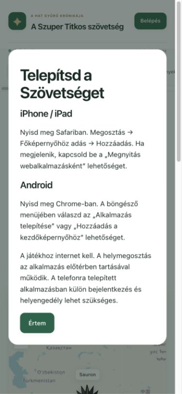
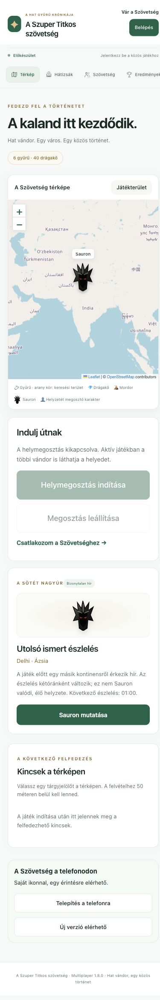
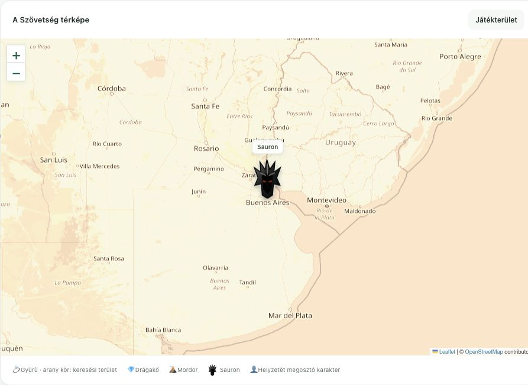
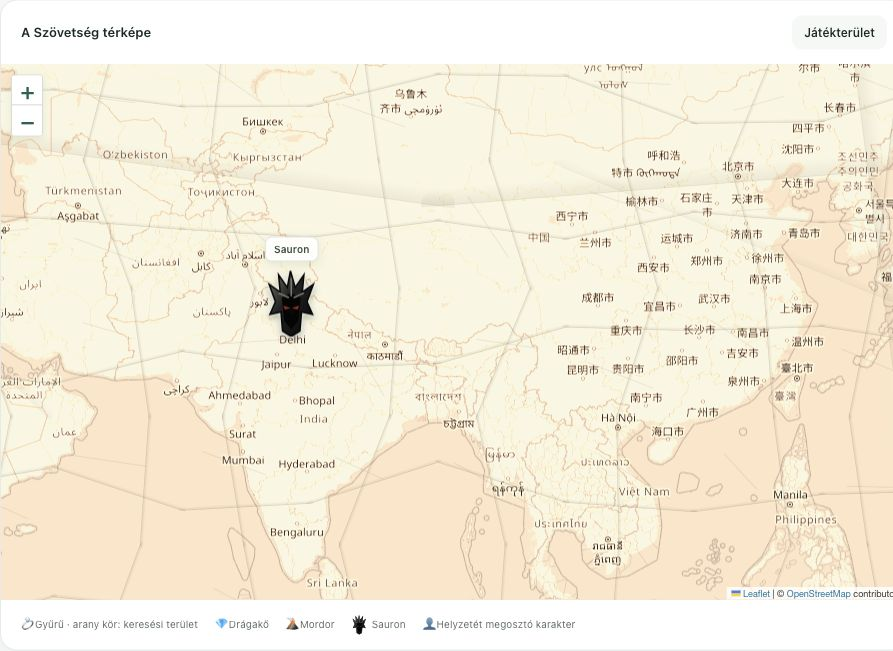
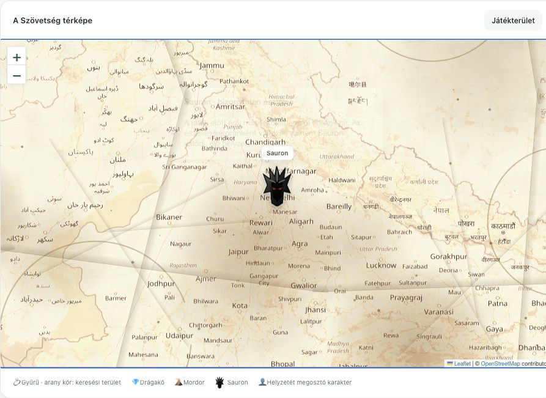

# Felhasználói kézikönyv

## Tartalomjegyzék

- [Erőteljesebb papíröregítés](#erőteljesebb-papíröregítés)

- [Földrajzilag rögzített papirusztextúra](#földrajzilag-rögzített-papirusztextúra)

- [Barnás pergamentérkép](#barnás-pergamentérkép)

- [Független háttérmotor és Sauron sebessége](#független-háttérmotor-és-sauron-sebessége)

- [Közös visszaszerzés értesítései](#közös-visszaszerzés-értesítései)

- [Részletes gyűrű- és Sauron-szabályok](#részletes-gyűrű--és-sauron-szabályok)

- [Üldözési emlékezet és részletes szabálykönyv](#üldözési-emlékezet-és-részletes-szabálykönyv)

- [Sauron aktuális helyének láthatósága](#sauron-aktuális-helyének-láthatósága)

- [Adminisztrátori kézi leállítás](#adminisztrátori-kézi-leállítás)

- [Aktuális webes és natív állapot](#aktuális-webes-és-natív-állapot)
- [Belépés utáni összesítő javítása](#belépés-utáni-összesítő-javítása)
- [Natív alkalmazás és tartós rablásjelzés](#natív-alkalmazás-és-tartós-rablásjelzés)
- [Gyűrűidő, szín és a kör végi térképkép](#gyűrűidő,-szín-és-a-kör-végi-térképkép)
- [Helyszínalapú random pálya](#helyszínalapú-random-pálya)
- [Megjelenítés, menü és random elhelyezés](#megjelenítés,-menü-és-random-elhelyezés)
- [Telepítés Androidra és iPhone-ra](#telepítés-androidra-és-iphone-ra)
- [Verziókövetés](#verziókövetés)
- [Mobilos és asztali webes nézet](#mobilos-és-asztali-webes-nézet)
- [Belépés és karakter](#belépés-és-karakter)
- [Játékos lépései](#játékos-lépései)
- [Admin lépései](#admin-lépései)
- [Hibaelhárítás](#hibaelhárítás)

## Verziókövetés

| Dokumentum | Játékverzió | Dátum | Változás |
| --- | --- | --- | --- |
| 1.0 | 1.5.3 | 2026-11-16 | Első kiadás a jelenlegi játékhoz. |
| 1.1 | 1.5.3 | 2026-11-16 | Mobilos és asztali webes útmutató képi illusztrációval. |
| 1.2 | 1.5.3 | 2026-11-16 | Áttekintve a technológiai leltár dokumentálásakor. |
| 1.3 | 1.5.3 | 2026-11-16 | Áttekintve a regressziós jegyzőkönyvezés bevezetésekor. |
| 1.4 | 1.6.0 | 2026-11-20 | Telepíthető mobilváltozat, használat, működés és korlátok dokumentálása. |
| 1.5 | 1.7.0 | 2026-11-20 | Belépett menü, világos/sötét megjelenítés és véletlen pályaterv. |
| 1.6 | 1.7.1 | 2026-11-20 | 1/3/5 km választó; gyűrűk és Mordor éttermeknél, kocsmáknál vagy nevezetességeknél. |
| 1.7 | 1.8.0 | 2026-11-21 | Gyűrűnkénti 60 perc, hat gyűrűs lezárás, színek, ikonbeállítás és körkép. |
| 1.8 | 1.8.0 | 2026-11-21 | Közös ötperces helymegosztás kiszabadítja Sauron gyűrűit. |
| 1.9 | 1.8.0 | 2026-11-21 | Telefonos sáv a Beállításokban és a térképoldal alján. |
| 1.10 | 1.8.0 | 2026-11-21 | Teljes szélességű, nagy helymegosztási gombok. |
| 1.11 | 1.8.0 | 2026-11-21 | Android/iPhone natív háttér-GPS igény rögzítve; a PWA korlátja változatlan, külön fejlesztés indul. |
| 1.12 | 1.9.0 | 2026-11-21 | Tartós, nyugtázható piros rablásjelzés és címzettvédett Realtime. |
| 1.13 | 1.9.0 | 2026-11-21 | Android/iPhone natív projektek, háttér-GPS és biztonságos munkamenethíd. |
| 1.14 | 1.9.1 | 2026-11-21 | Natív appkészítés elhalasztva, kód és eredmények megőrizve; automatikus fordítás kikapcsolva. |
| 1.15 | 1.9.1 | 2026-11-21 | Böngészős automatikus megosztásfolytatás kérése visszavonva; marad a kézi újraindítás. |
| 1.16 | 1.9.2 | 2026-11-21 | A felhasználó jóváhagyta a natív app folytatását; böngészős kézi GPS működés megmarad. |
| 1.17 | 1.9.3 | 2026-11-21 | Történeti popup tiltása belépéskor, körhöz kötött térkép; natív sikeres build és korlátok ellenőrizve. |
| 1.18 | 1.9.4 | 2026-11-21 | Admin kézi megszakítás visszaállítva, jogosultság és megerősítés tesztelve; az 1.9.3 élesítése igazolt. |
| 1.19 | 1.9.5 | 2026-11-21 | Sauron élő helye csak saját gyűrűvel és friss saját helymegosztással látható; szerverválasz és kliens ellenőrizve. |
| 1.20 | 1.9.6 | 2026-11-21 | Utolsó észlelési pontig tartó üldözés; játékbeli és Markdown szabálykönyv részletesítve. |
| 1.21 | 1.9.6 | 2026-11-21 | Közös kiszabadítás előtt minden földi gyűrűt be kell gyűjteni; számláló, felület és szabályok frissítve. |
| 1.22 | 1.9.7 | 2026-11-21 | Indulási és sikeres visszaszerzési popup minden játékosnak; bezárásuk nem állítja le a megosztást. |
| 1.23 | 1.9.8 | 2026-11-21 | Önálló 10 másodperces szerveridőzítés; Sauron 15 km/h, megosztási szünetben is mozog. |
| 1.24 | 1.9.9 | 2026-11-21 | A háttértérkép barnás pergamen szűrőt kapott; a jelölők, vezérlők és játékosszín változatlan. |
| 1.25 | 1.10.0 | 2026-11-21 | Gyűrődések és hajtások földrajzi rögzítésű Canvas-rétegen, determinisztikus nagyítás és csempeillesztés. |
| 1.26 | 1.10.1 | 2026-11-21 | Vizuális finomítás: cellák között összefüggő fő hajtások, lágyabb és lekerekített gyűrődésárnyékok. |
| 1.27 | 1.10.2 | 2026-11-21 | Erősebb és sűrűbb papíröregítés: barnás foltok, víznyomok, oxidációs pöttyök, kopás és több gyűrődés. |

## Mobilos és asztali webes nézet

Az ábra felső sora a mobilos, az alsó az asztali webes használatot szemlélteti. Balról jobbra a belépés, a térképes játék és a városbeállítás látható. A gombok helye az ábrán és a tényleges felületen eltérhet.

| Művelet | Mobilböngésző | Asztali böngésző |
| --- | --- | --- |
| Belépés | Nyisd meg a **Belépés** menüt, majd görgess a megfelelő űrlaphoz. | Nyisd meg a **Belépés** menüt, és válaszd a visszatérő vagy az új karakter űrlapját. |
| Térkép | Húzd ujjal a térképet, nagyíts két ujjal vagy a + gombbal. A térkép alá görgetve éred el a helymegosztást és a kincsek listáját. | Húzd egérrel a térképet, használj görgőt vagy +/− gombot. A helymegosztás széles nézetben a térkép mellett található. |
| Helymegosztás | Aktív körben indítsd el a megosztást, és engedélyezd a helyhozzáférést a böngészőben. Terepen a telefont használd a gyűrű felvételéhez. | Ugyanazzal a gombbal indítható. A helymeghatározás pontossága az eszköztől függ, ezért a térkép és a kezelőfelület asztalon akkor is használható áttekintésre, ha a GPS pontatlan. |
| Adminisztráció | Ha az **Admin** menü kívül esik a képernyőn, görgesd oldalra a menüsort. A helyszínt érintéssel jelöld ki. | Az **Admin** menüben fogadd el a várost, majd a szerkesztőben egérkattintással helyezd el a pontokat. |

## Belépés és karakter

Nyisd meg a [játékot](https://ngynrbrt-prog.github.io/szuper-titkos-szovetseg/?v=1.8.0). Az **Új karakter** űrlapon válassz nevet, 6–12 számjegyes PIN-t, fajt és fegyvert. A **Visszatérő vándor** űrlapon lépsz be. A térképes ikont a **Beállítások → Térképes karakterikon → Ikon mentése** útvonalon állíthatod át.

## Játékos lépései

1. Aktív körben nyisd meg a **Térkép** oldalt, és indítsd el a helymegosztást. A friss, megosztott helyeket karakterikonok jelölik.
2. Az arany keresőkör segít megtalálni a gyűrűt. Saját gyűrűvel és aktív megosztással megjelenik a pontos jelölő.
3. Menj a tárgy tényleges helyétől 50 méteren belülre, majd válaszd a **Felveszem · 50 m** gombot. A műveletet a térképi jelölő felugró ablakából indítsd; belépett nézetben nincs külön kincslista.
4. A **Szövetség** oldalon választhatsz rablást, ha mindkét játékos megosztja friss helyét és 100 méteren belül vannak egymáshoz. A páros rablási védelem 15 perc.
5. A **Hátizsákban** legalább 60 perc gyűrűnkénti igazolt helymegosztás után, Mordor 50 méteres körzetében semmisítheted meg a saját gyűrűdet. Több gyűrűnél elérhető az együttes megsemmisítés is. A kör a hatodik gyűrű megsemmisülésekor ér véget, ekkor jelenik meg az eredményablak. Az **Eredmények** oldalon a pontok és a korábbi körök is láthatók.

## Admin lépései

1. **Admin → Új városi kaland** alatt írd be a települést, például Gárdonyt, majd nyomd meg a **Város elfogadása** gombot. Több találat esetén válassz a listából. Korábbi helyszínek esetén a váltás megerősítést kér.
2. **Helyszínek kijelölése a térképen** alatt válaszd ki a hat gyűrű helyét név szerint, Mordort és Sauron útvonalát. A pontok a központ 10 km-es körzetébe kerüljenek. Külön drágakőhelyeket is megadhatsz.
3. Ellenőrizd a helyek és az útvonal gyalogos megközelíthetőségét, jelöld be a jóváhagyást, majd válaszd az **Előkészített játék létrehozása** és a **Játék indítása** gombot.
4. Az aktuális kör még földön lévő gyűrűit a **Gyűrűk helyének módosítása** gombbal mozgathatod. Jelölj ki új pontot, hagyd jóvá és mentsd. Új körhöz térj vissza az új játék űrlapjához.

## Hibaelhárítás

Ha a gyűrűfelvétel sikertelen, ellenőrizd, hogy aktív-e a kör, engedélyezett-e a helymegosztás, elég friss-e a GPS és a gyűrű még a földön van-e. Ha az új funkció hiányzik, frissítsd az oldalt a kiadási hivatkozásról. Az éles változat azonosítója a [kiadási dokumentumban](RELEASE-ELESITES.md) található.

## Telepítés Androidra és iPhone-ra

1. Nyisd meg a játékot a telefon böngészőjében, majd válaszd a **Telepítés a telefonra** gombot.
2. **Android / Chrome:** ha megjelenik, fogadd el a telepítést; egyébként a böngésző menüjében válaszd az **Alkalmazás telepítése** vagy **Hozzáadás a kezdőképernyőhöz** pontot.
3. **iPhone / Safari:** **Megosztás → Főképernyőhöz adás → Hozzáadás**. Ha megjelenik a **Megnyitás webalkalmazásként**, legyen bekapcsolva.
4. Indítsd a zöld, arany gyűrűs ikonról. A telepített alkalmazás külön bejelentkezést és helyengedélyt kérhet. A helymegosztást indítsd újra.
5. Az **Új verzió elérhető** gombbal frissíthetsz. Ez újratölti a felületet és megszakítja a helymegosztást, ezért utána ellenőrizd és indítsd újra.

A játékhoz internet szükséges. Kapcsolatvesztéskor figyelmeztetés jelenik meg, offline indításkor pedig újrapróbálási oldal. Tartsd az alkalmazást előtérben és a kijelzőt bekapcsolva a helymegosztáshoz. Törlés: a telefonon hosszan nyomd az ikont, majd válaszd az eltávolítást. A böngésző és az alkalmazás adatai külön is megmaradhatnak.

## Megjelenítés, menü és random elhelyezés

Belépés után a fejlécben **Belépve: karakternév** látszik a **Kilépés** előtt. A Belépés gomb eltűnik. A **Beállítások → Megjelenítés** alatt válassz **Világos** vagy **Sötét** módot, majd **Beállítás mentése**. A választás ezen az eszközön, karakterenként mentődik; másik telefonon külön állítható. Az **Admin** menüpont kizárólag a belépett admin számára látszik.

A térképi tárgyjelölőre vagy gyűrű-keresési jelölőre bökve nyisd meg a felvételi műveletet. Belépve nincs külön „A következő felfedezés” tárgylista. A szükséges távolság, friss GPS és aktív játék továbbra is feltétel.

**Véletlen pálya:**

1. Admin → Új városi kaland: fogadd el a várost, majd nyisd meg a térképes szerkesztőt.
2. Válassz **1 km**, **3 km** vagy **5 km** sugarat a listából; alapérték 1 km.
3. Nyomd meg a **Random elhelyezés** gombot, majd bökj a kívánt középpontra. A gomb ismételt megnyomásával megszakíthatod a módot. A teljes kör maradjon a városközpont 10 km-es körzetében.
4. Korábbi tervnél erősítsd meg a lecserélést. 6 gyűrű, 20 drágakő, Mordor és Sauron útvonala jelenik meg. A jelenlegi játékot ez még nem változtatja meg.
5. Vizsgáld át az összes pontot és útvonalszakaszt. Húzással módosíthatod a jelölőket; a véletlen útvonal nem követi automatikusan az utcákat. Vízre, magánterületre vagy veszélyes helyre eső pontot helyezz át.
6. Jóváhagyás után hozd létre az előkészített játékot, és csak ellenőrzés után indítsd el. Kézi tervnél a korábbi 40 drágakő az alapérték; generált tervnél 20.

## Helyszínalapú random pálya

A **Random elhelyezés** mellett a lenyíló listában **1 km**, **3 km** vagy **5 km** választható. Térképkattintás után várd meg az éttermek, kocsmák és nevezetességek keresését. A hat gyűrű és Mordor az ilyen helyekre kerül; a nevük megjelenik a szerkesztőben. Kevés találatnál válassz nagyobb sugarat vagy másik középpontot. Hálózati hibánál próbáld később: a korábbi terv nem vész el.

A generált gyűrűt és Mordort ismert helyszín közelébe húzva vagy kattintva a jelölő a helyszín koordinátájára illeszkedik. 150 méteren belüli megfelelő hely hiányában az áthelyezés elutasított. Újratöltés után a hét kiválasztott hely marad ismert; más helyekhez új generálást indíthatsz. A térképes adatok lehetnek elavultak, a hely nyitvatartását, megközelíthetőségét és a teljes útvonalat indulás előtt ellenőrizd. A véletlenül generált drágakő és útvonalpont továbbra is kézzel áthelyezhető.

## Gyűrűidő, szín és a kör végi térképkép

**Beállítások:** itt találod a térképes karakterikon, az egyedi játékosszín és a világos/sötét megjelenítés választóját. Nyolc alapszín elérhető: piros, kék, zöld, sárga, narancs, lila, rózsaszín, barna. Foglalt szín nem választható; aktív játékban a színmező zárolt. A Szövetség névsorában a választott karakterikon és egy színjelzés látszik a név mellett.

**Hátizsák:** minden saját gyűrű mellett kis gyűrűkép, haladási sáv és „perc/mp / 60 perc” érték látható. Az idő csak a gyűrű birtoklása közbeni, friss bekapcsolt helymegosztásokból gyűlik. Szünetben nem halad, elvesztés vagy új tulajdonos után nulláról indul. 60 percig a megsemmisítés gomb tiltott; utána is Mordor 50 m-es körzete és friss GPS szükséges. Több gyűrű együttes megsemmisítéséhez mindegyik saját gyűrűnek külön teljesítenie kell az egy órát.

A rendes aktív kör mind a hat gyűrű megsemmisülésekor ér véget; az admin külön megerősítéssel győzelem nélküli megszakítást is kérhet. a pontszám alapján készül a rangsor. Sauron minden gyűrű megszerzésével sem fejezi be a kört. A még el nem indított játékot az admin az Előkészület elvetése gombbal törölheti az aktív előkészületek közül.

**Közös kiszabadítás:** ha Sauronnál van gyűrű, minden regisztrált játékosnak egyszerre kell helyet megosztania öt percen át, új elfogás nélkül. A térkép melletti helymegosztási kártya mutatja az X/Y játékost és a közös időt. Leállítás, 30 másodpercnél régebbi GPS vagy új elfogás újrakezdi az öt percet. Siker esetén Sauron összes gyűrűje visszakerül eredeti helyére, ismét felvehető, és az új birtokos egyórás számlálója nulláról indul.

**Kör végi térképkép:** az eredményablakban megjelenik a kiválasztott város és a kör alatt megosztott, játékosszínű útvonalak képe. A Térképkép mentése link PNG-ként letölti. A megosztási szüneteket nem köti össze a vonal. Előfordulhat hiányos háttértérkép; ilyenkor az Újrapróbálás gombbal kérheted újra. A PNG nincs a szerverre vagy GitHubra feltöltve.

**Helyadatok:** az aktív körben bekapcsolt megosztásból útvonalminták tárolódnak, hogy a lezáráskor minden regisztrált játékos lássa a térképet. 30 nap után már nem érhetők el; a lejárt minták törlése a következő játékkéréskor történik. Korábbi, még nem rögzített köröknél nincs visszamenőleges útvonal.

**Telefonos sáv és nagy gombok:** a Szövetség a telefonodon sáv a Beállításokban és a kezdő Térkép oldal legalján található. Más oldalon nem jelenik meg. A Helymegosztás indítása és Megosztás leállítása teljes kártyaszélességű, nagy gomb; mobilon a térkép alatt helyezkedik el.

A lezárt képernyős, bezárt oldalas folyamatos GPS Androidon és iPhone-on külön natív alkalmazást igényel. Az 1.8.0 webes változat ezt nem teljesíti, nem címkéz elavult helyadatot frissként. Források: [Android háttérhelymeghatározás](https://developer.android.com/develop/sensors-and-location/location/background), [Apple Core Location](https://developer.apple.com/documentation/corelocation/handling-location-updates-in-the-background).

## Natív alkalmazás és tartós rablásjelzés

Ha meglopnak, a kezdő térképoldal piros doboza kiírja: **Rablás történt**, valamint az elrabolt tárgy nevét és a rabló karakternevét. A doboz addig marad, amíg a saját fiókoddal meg nem nyomod a **Rendben** gombot. Újranyitás után is visszatér, ha még nem nyugtáztad. A valós idejű kapcsolat megszakadásánál a következő sikeres állapotlekérés hozza meg a jelzést.

A natív Android/iPhone app használatát és telepítését a [mobil útmutató](../mobile/README.md) írja le. Androidon pontos hely és állandó megosztási értesítés szükséges; a helymegosztás az értesítésből is leállítható. iPhone-on Mindig helyengedély szükséges; a rendszer engedélykérési lépései miatt ezt a telefon Beállításaiban is be kell kapcsolni, majd újra indítani a megosztást. A saját natív appban a Telefonra telepítés PWA-sáv nem jelenik meg, mert már telepített appot használsz.

A kijelző lezárása és az app háttérbe tétele mellett a natív helyszolgáltatás működhet tovább. Kényszerített leállítás, jogosultságvisszavonás, energiatakarékosság és GPS/hálózati hiány esetén ez megszakadhat. Csak a szerverhez érkezett friss, elfogadott mérés számít a gyűrű- és csapatidőbe. Normál böngészőben/PWA-ban továbbra is előtérben kell tartani az oldalt a megbízható GPS-hez.

## Aktuális webes és natív állapot

Az Android/iPhone fejlesztés a felhasználó jóváhagyása alapján folytatódott. A korábbi halasztás történeti döntés, nem jelenlegi korlátozás. Az Android 1.9.2 teszt-APK és az aláírás nélküli iOS-szimulátor build sikeres a [44842967106 futásban](https://github.com/ngynrbrt-prog/szuper-titkos-szovetseg/actions/runs/44842967106), forrás: `2dded917eb8561da9c27195eb1c7cbda439c2fdc`. Android build és lint sikeres; az első futás hibáját az AndroidX OnBackPressedDispatcher javította. [Android ZIP](https://github.com/ngynrbrt-prog/szuper-titkos-szovetseg/actions/runs/44842967106/artifacts/14681647800): kicsomagolás után az app-debug.apk telepíthető tesztelésre. Fizikai telefonos háttér-GPS még nem igazolt. Az iPhone valódi készülékes telepítéséhez aláírás szükséges; a felhasználónak nincs Apple-fejlesztői hozzáférése, aláírt iPhone-telepítő nincs.

A böngésző/PWA továbbra is használható; a natív híd normál böngészőben nem aktiválódik. Böngészős szünet után kézi helymegosztás-indítás szükséges, automatikus újraindítást a felhasználó nem kért. A szünet alatt nincs gyűrűidő-jóváírás.

## Belépés utáni összesítő javítása

Az 1.9.3 nem nyitja meg belépéskor egy korábban befejezett játék eredményablakát és térképét. Az aktív Gárdony-játék mellé így nem kerül a régi prágai kör képe. Az összesítő csak a bejelentkezve megfigyelt aktív kör befejezésekor jelenik meg, ugyanannak a körnek az azonosítójával és térképével. Ismételt állapotlekérés nem nyitja újra. Kijelentkezés törli a kliens körfigyelését; az adatbázis és a régi eredmények megmaradnak.

Automatizált ellenőrzés: 13 sikeres JavaScript-tesztcsomag, köztük a belépés, Gárdony/Prága eltérés, ismétlés, kijelentkezés és gyors új játék esetei. [Jegyzőkönyv](tesztjegyzokonyvek/2026-11-21-popup-1.9.3.md).

## Adminisztrátori kézi leállítás

Aktív játékban az Admin → Aktuális játék résznél a **Játék kézi leállítása** gomb jelenik meg. Megerősítés után megszakítja a futó kört: nincs győzteshirdetés vagy kör végi győzelmi térkép, a szerver kikapcsolja a kör helymegosztásait és az ötperces közös számlálót. Az adatokat megőrzi, admin_cancel eseményt naplóz. Az admin ezután új játékot konfigurálhat. Előkészített játékban ugyanitt **Előkészület elvetése** látható. Lezárt körnél a gomb inaktív. A rendes győzelmi feltétel továbbra is mind a hat gyűrű megsemmisítése.

A game_action új abort művelete élő munkamenetet és adminjogot ellenőriz, valamint confirm=true és az aktuális game azonosítóját kéri. Másik körre elavult gombnyomás nem állíthat le játékot. A frontend megerősítés elutasításakor nem küld kérést. A korábbi finish művelet továbbra is csak előkészületet vet el. A restore_explicit_admin_manual_stop migráció csak a függvényt bővíti, a futó éles kört nem állítja le. [Tesztjegyzőkönyv](tesztjegyzokonyvek/2026-11-21-admin-leallitas-1.9.4.md).

## Sauron aktuális helyének láthatósága

Az 1.9.5-ben aktív játék alatt minden játékos csak akkor láthatja Sauron aktuális helyét, ha **saját birtokában van legalább egy gyűrű**, és **a saját helymegosztása aktív, 30 másodpercnél frissebb, legfeljebb 50 m pontatlanságú**. Más játékos gyűrűje vagy megosztása nem elegendő; adminjog nem ad kivételt. A feltételek megszűnésekor a következő állapotfrissítés elrejti Sauront. A rablás utáni rejtőzési időben jogosult játékosnak sem látható. A játék előtti, kétóránként váltakozó más kontinenses észlelés változatlan.

A game_action a válasz sauron mezőjét az adott kérőre ellenőrzi. A game.config válaszából mindenkinél kihagyja a sauron_position, sauron_tick_at és sauron_target belső mezőket; a szerveroldali üldözéshez az adatbázisban megmaradnak. A kliens nem következtet helyre a járőrútvonalból, rejtett állapotban nincs jelölő és a Sauron mutatása gomb tiltott. Az üldözési szabály továbbra is csak friss helyet megosztó gyűrűbirtokost céloz.

Migráció: sauron_visible_only_to_sharing_ring_owner; forrás: database/sauron-visibility.sql. [Tesztjegyzőkönyv](tesztjegyzokonyvek/2026-11-21-sauron-lathatosag-1.9.5.md).

## Üldözési emlékezet és részletes szabálykönyv

Az 1.9.6-ban Sauron a kiválasztott gyűrűbirtokos utolsó érvényes megosztott helyét megőrzi. Friss új mérés frissíti a célt. A megosztás leállításakor vagy elavulásakor nem fordul azonnal vissza, hanem eléri a megjegyzett pontot. Megszűnt megosztásból nincs elfogás. Ha a megjegyzett pont üres, az emlékezet törlődik, és a következő kiértékelés új célpontot keres, ennek hiányában a járőrútvonal felé mozog. Sebesség és kérésvezérelt időléptetés változatlan. Az új belső sauron_last_seen és sauron_pursuit_player mezők sem kerülnek a klienshez. Migráció: sauron_reaches_last_seen_location, forrás database/sauron-last-seen.sql.

A közös kiszabadítás csak akkor indulhat, ha nincs a földön felvehető gyűrű: a nem Sauronnál lévő, meg nem semmisített gyűrűk mind játékosok birtokában vannak. Ezután mind a regisztrált játékosok ötpercnyi egyidejű friss helymegosztása kell; a korábbi megosztási idő nem előleg. Földön maradó gyűrű megszakítja/nullázza az időt. A megsemmisített gyűrűk nem akadályok. Ha minden megmaradt gyűrű Sauronnál van, a gyűjtési feltétel teljesült, de a közös öt perc kötelező. A térképi kártya jelzi, hány gyűrűt kell még összegyűjteni. Migráció: rescue_requires_all_ground_rings_collected, forrás database/rescue-all-rings-collected.sql.

A játék Szabályok oldala és a [részletes szabálykönyv](SZABALYKONYV.md) 11 fejezetben, 30 bekezdésben tartalmazza a tényleges gyűrűfelvételt, az egyórás saját időt, a rablást, a megsemmisítést, Sauron láthatóságát, üldözését, elfogását, a visszaszerzést, a közös kiszabadítást és a pontozást. Fantáziaképességek díszítő jellegűek, nincs nem megvalósított képesség működőként feltüntetve. [Tesztjegyzőkönyv](tesztjegyzokonyvek/2026-11-21-sauron-emlekezet-1.9.6.md).

## Részletes gyűrű- és Sauron-szabályok

### A kör és a cél

Legfeljebb hat regisztrált játékos játszik az admin által kiválasztott városban. Egy körben hat gyűrű és a pályaterv szerint húsz vagy negyven drágakő található. Az admin előkészíti a helyszíneket, majd elindítja a kört. Előkészületben nincs gyűjtés vagy időjóváírás.

A rendes kör akkor ér véget, amikor mind a hat gyűrű megsemmisült. Egyetlen gyűrű megsemmisítése, illetve az, hogy Sauronnál van az összes gyűrű, nem fejezi be a játékot. Az admin külön megerősítéssel kézzel megszakíthatja a futó kört; ez nem győzelem, nincs győzteshirdetés. Új körhöz új pályát kell konfigurálni.

### A hat gyűrű és felvételük

A gyűrűk neve: Anor Arany Fénye, Barad Rubin Lángja, Elbereth Kék Csillaga, Lórien Zöld Álma, Khazad Ezüst Pajzsa és Ithil Lila Árnya. A nevekhez tartozó fantáziaképességek jelenleg díszítő jellegűek: egyik gyűrű sem ad külön sebességet, láthatatlanságot vagy harci bónuszt. A működő gyűrűszabályok mind a hat gyűrűre azonosak.

Amíg nincs nálad gyűrű, a földön lévő gyűrű körvonalas jelölővel, körülbelül 50 méter sugarú keresési körben látszik, helymegosztás nélkül is. Ez keresési terület, nem a pontos felvételi pont. Ha már van saját gyűrűd és frissen megosztod a helyedet, a többi földön lévő gyűrű pontos jelölőjét is láthatod.

Felvételhez aktív játék, bekapcsolt saját helymegosztás, friss és pontos GPS, valamint a tárgy tényleges helyétől legfeljebb 50 méter szükséges. A térképi jelölőre kattintva nyisd meg a tárgy műveletét. A keresési kör látványa önmagában nem jogosít felvételre. A már felvett tárgy másnak nem vehető fel újra; az első sikeres szerverkérés számít. Több gyűrűt is tarthatsz a Hátizsákban.

### Gyűrűnkénti egy óra helymegosztás

Minden gyűrű saját számlálót kap. A megsemmisítéshez az adott gyűrűnek a saját birtokodban kell lennie, és vele legalább 60 perc elfogadott helymegosztást kell összegyűjtened. A Hátizsákban a gyűrű képe mellett követhető az idő és az állapot. Több nálad lévő gyűrű számlálója párhuzamosan nő, de egy később felvett gyűrű nem kapja meg a korábbi gyűrűvel gyűjtött időt.

A hely frissességi határa 30 másodperc, az elfogadott pontatlanság legfeljebb 50 méter. Az idő a szerver által elfogadott, egymást követő friss mérések között gyűlik; megosztási szünet vagy elavult mérés alatt nincs jóváírás. A képernyőn futó óra, a bejelentkezés hossza vagy a saját telefon órája önmagában nem számít.

Példa: 25 perc elfogadott megosztás után leállítod a megosztást, a gyűrű nálad marad. A 25 perc megmarad, de a szünet nem növeli. Újraindítás után további 35 elfogadott perc kell. Rablás, Sauron általi elvétel, visszaszerzés vagy új felvétel után az érintett gyűrű számlálója nulláról indul: másik birtokos idejét nem öröklöd. A számláló 60 percnél eléri a megsemmisítési küszöböt.

### Megsemmisítés Mordornál

Saját gyűrűt a kijelölt Mordor-pont legfeljebb 50 méteres körzetében, friss saját GPS-szel semmisíthetsz meg, ha annak számlálója elérte a 60 percet. A Hátizsákban válaszd a Megsemmisítés Mordornál gombot és erősítsd meg. A művelet gyűrűnként 1 000 sestertiust ér; a gyűrű végleg kikerül a körből.

Ha több gyűrűd van, az Összes gyűrű megsemmisítése gomb az összes saját gyűrűdre vonatkozik. Mindegyiknek külön teljesítenie kell a 60 percet. Ha akár egyetlen gyűrű ideje kevés, a teljes közös művelet elutasításra kerül, egyik gyűrű sem semmisül meg. A már jogosult gyűrűt külön is megsemmisítheted.

### Rablás játékosok között

A Szövetségben másik játékos egy általa birtokolt tárgyát rabolhatod el, ha mindketten friss, pontos helyet osztotok meg, és legfeljebb 100 méterre vagytok egymástól. Egy művelet egy tárgyat érint. A két érintett játékos között ezután 15 percig egyik irányban sem lehet újabb rablás. Ez a páros védelem nem ad általános védelmet Sauron vagy más játékosok ellen.

A kirabolt játékos piros Rablás történt üzenetet kap az elrabolt tárgy nevével. Az üzenet csak a Rendben megnyomásával tűnik el, új belépéskor is megmarad. A korábban megszerzett pontokat a rablás nem vonja vissza, és a lopott drágakő nem ad újabb felvételi pontot. Az elrabolt gyűrű időszámlálója az új birtokosnál nulláról indul.

### Mikor látod Sauront?

A játék előtt Sauron fekete sisakja egy másik kontinensről szóló, kétóránként változó bizonytalan észlelést jelöl. Ez nem az aktív játékbeli valódi helye.

Futó játékban Sauron aktuális helyét csak akkor láthatod, ha legalább egy saját gyűrűd van, és a saját helymegosztásod bekapcsolt, friss és pontos. Más játékos gyűrűje vagy megosztása neked nem ad láthatóságot; az adminra is ugyanaz a feltétel érvényes. Ha leállítod a megosztást, elavul a mérés vagy elveszíted az utolsó gyűrűdet, a következő állapotfrissítés elrejti Sauront. Rejtett állapotban a Sauron mutatása gomb nem használható.

Sauron elrejtése a térképeden nem állítja meg a mozgását, és nem törli az utolsó ismert célját. A rablás utáni 60 perces rejtőzési időben akkor sem látszik, ha egyébként teljesíted a feltételeket.

### Sauron üldözése és az utolsó ismert hely

Sauron friss helyet megosztó gyűrűbirtokost keres. Ha nincs megjegyzett célja, a hozzá legközelebbi ilyen játékost választja. Gyűrű nélküli játékos pusztán helymegosztással nem indít üldözést. A mozgási sebesség 15 km/h, a térképen egyenes szakaszokon halad; a rendszer nem gyalogos útvonaltervező.

A kiválasztott gyűrűbirtokos friss helyét megjegyzi. Amíg az illető új, érvényes helyet oszt meg és gyűrűje van, az üldözési cél a legutóbbi ilyen mérésre frissül. A megjegyzett cél eléréséig nem vált át önkényesen egy másik játékosra.

Ha az üldözött leállítja a megosztást, elveszíti a gyűrűjét vagy a GPS-e elavul, Sauron nem fordul azonnal vissza. Folytatja az utat a legutolsó érvényesen látott helyhez. A kikapcsolt megosztású játékost ettől még nem foghatja el, akkor sem, ha fizikailag ott maradt.

Ha elérte az utolsó ismert pontot, és a céljátékos ott már nem ad érvényes, gyűrűs helymegosztást, törli ezt az üldözési emléket. A következő szerverértékeléskor új érvényes célpontot kereshet, ennek hiányában visszaindul az admin által kijelölt járőrútvonala felé. Nem ugrik vissza az útvonalra, hanem oda is a mozgási sebességével halad. Példa: A pontnál kikapcsolod a megosztást és továbbmész B-be. Sauron A-hoz megy; B-ről nem tud új, megosztott mérés nélkül.

### Elfogás és egyéni visszaszerzés

Sauron legfeljebb 50 méteren belül elvehet egy gyűrűt a célba vett, éppen friss és pontos helyet megosztó gyűrűbirtokostól, ha az illetőnek nincs Sauron elleni átmeneti védettsége. Egy elfogás egy gyűrűt vesz el, nem a teljes hátizsákot. A gyűrű ideje nullázódik.

Sikeres elfogás után Sauron 60 percig rejtve marad és nem támad. A rejtőzési idő nem jelent mozgásleállást. A játék akkor is folytatódik, ha minden megmaradt gyűrű Sauronhoz került.

A Sauron által elvett gyűrűt csak az a játékos szerezheti vissza egyénileg, akitől Sauron elvette. Ehhez aktív kör, friss saját helymegosztás és Sauron tényleges helyétől legfeljebb 1 km szükséges. A Hátizsák Visszaszerzem · 1 km művelete ezt szerveroldalon ellenőrzi; a visszaszerzési lehetőség nem garantálja, hogy éppen látod Sauront. Siker után a gyűrű számlálója nulláról indul, és a játékos 15 perc Sauron elleni védettséget kap. Ez nem azonos a játékosok közötti páros rablásvédelemmel.

### Közös ötperces kiszabadítás

A közös kiszabadításnak két egyidejű előfeltétele van: a térképen egyetlen felvehető gyűrű sem maradhat, és minden regisztrált játékosnak egyszerre öt percig kell aktív, friss és pontos helyet megosztania. Minden meg nem semmisített, nem Sauronnál lévő gyűrűt előbb valamelyik játékosnak kell birtokolnia; lehetnek egy vagy több játékosnál, nem kell mindenkinek saját gyűrű. A megsemmisített gyűrűt nem kell összegyűjteni. Ha minden megmaradt gyűrű Sauronnál van, nincs felszedendő gyűrű, de a közös öt perc akkor is szükséges. Az óra csak mindkét feltétel teljesülése után indul, az előtte megosztott idő nem számít bele. A gyűrű nélküli regisztrált játékos is beleszámít a szükséges létszámba. A kártya mutatja a megosztó/összes játékos létszámot és a közös időt.

Leállítás, elavult GPS, új elfogás, a térképen maradó felvehető gyűrű vagy a folyamatos szerverellenőrzés megszakadása újrakezdi az öt percet. Offline idő nem számít. Siker esetén az összes Sauronnál lévő gyűrű visszakerül a saját eredeti indulási helyére, ismét bárki felveheti a szokásos 50 méteres feltételekkel. A számlálójuk nullázódik. A kiszabadítás önmagában nem ad győzelmet vagy pontot.

A közös ötperces visszaszerzés indulásakor minden játékos tájékoztató popupot kap: minden regisztrált játékos megoszt, és a gyűrűvisszaszerzés folyamatban van. Sikeres befejezéskor külön popup jelzi, hány gyűrű került vissza eredeti helyére. Mindkét ablak a Rendben, bezárás gombbal bezárható. Az értesítés bezárása nem változtat a helymegosztás állapotán: ha az aktív volt, aktív marad. Ha le akarod állítani, külön nyomd meg a térképen a Megosztás leállítása gombot. Az értesítések a szerverállapot frissítésekor jelennek meg, nem telefonos push üzenetek; ugyanazt a bezárt eseményt ugyanannál a játékosnál, ugyanabban a böngészőben nem ismételjük.

### Pontozás és a kör eredménye

A drágakő értéke a sorszámának ezerszerese: 1 000-től húsz darabos körben 20 000, negyven darabos körben 40 000 sestertiusig. Első felvételkor írjuk jóvá. A gyűrű puszta felvétele nem ad 1 000 pontot, annak megsemmisítése ad gyűrűnként 1 000 sestertiust. A sikeres rablások száma külön statisztika.

A sorrend elsődlegesen a megszerzett sestertius, egyezéskor a megsemmisített gyűrűk száma, majd a gyűrűbirtokosként gyűjtött összesített megosztási idő. Ez az utolsó statisztika játékosidő, nem a párhuzamosan hordott gyűrűk számával szorzott idő. Teljes egyezéskor a szerver játékosazonosító alapján ad stabil sorrendet.

A hatodik gyűrű megsemmisítése után a bejelentkezve követett kör játékosainak megjelenik az eredményablak a megszerzett tárgyak statisztikájával és a kör városának színes megosztási térképével. Belépéskor nem ugrik fel egy régi kör térképe. Adminisztrátori megszakításnál nincs győzelmi összesítő.

### Helymegosztás, frissítés és biztonság

A bekapcsolt helymegosztás a karaktered választott ikonjával és színével mutat a többi játékosnak. Böngésző/PWA háttérbe kerülése, képernyőzár vagy kapcsolatvesztés megszakíthatja; ilyenkor kézzel kell újraindítani. A natív Android/iPhone kód háttér-GPS-re készült, de a fizikai készülékes folyamatos működés még külön tesztet igényel, az iPhone telefonos telepítéséhez aláírás kell. A tesztalkalmazás nem ad korlátlan működési garanciát.

A felület nagyjából tíz másodpercenként frissül. Sauron mozgását és a kiszabadítást a szerver saját, tíz másodpercenként futó háttérmotorja is értékeli, a játékosok játékkéréseitől és helymegosztásától függetlenül. Hosszú kéréskimaradás után nem szimulál korlátlan offline időt: egy mozgáslépés legfeljebb 30 másodpercet vesz figyelembe. A szerver által elfogadott állapot a mérvadó.

Aktív megosztásból útvonalminták tárolódnak a kör végi közös térképhez. Kikapcsolt megosztásból nincs új minta; az adatok legfeljebb 30 napig érhetők el, a lejártak törlését a következő játékkérés végzi. Kizárólag ellenőrzött nyilvános gyalogoshelyszíneken játsszatok. Ne lépj magánterületre vagy úttestre, és vezetés közben ne használd a játékot. A telefon GPS-e manipulálható: ez baráti játék, nem hitelesített helymérés.

## Közös visszaszerzés értesítései

A közös ötperces visszaszerzés indulásakor minden játékos tájékoztató popupot kap: minden regisztrált játékos megoszt, és a gyűrűvisszaszerzés folyamatban van. Sikeres befejezéskor külön popup jelzi, hány gyűrű került vissza eredeti helyére. Mindkét ablak a Rendben, bezárás gombbal bezárható. Az értesítés bezárása nem változtat a helymegosztás állapotán: ha az aktív volt, aktív marad. Ha le akarod állítani, külön nyomd meg a térképen a Megosztás leállítása gombot. Az értesítések a szerverállapot frissítésekor jelennek meg, nem telefonos push üzenetek; ugyanazt a bezárt eseményt ugyanannál a játékosnál, ugyanabban a böngészőben nem ismételjük.

A rescue-notices.js a hitelesített állapotból a game.config.rescue_started_at és rescue_completed_at/rescue_released szervermezőket figyeli. Egyedi játékos/kör/eseménytípus/időbélyeg kulcs alapján sorba állítja az üzeneteket. A bezárás localStorage nyugtát ment, külön játékosra és böngészőre; nem hív stop vagy helymeghatározási API-t. Kijelentkezés lezárja a megjelenített ablakot és üríti a sort. A kör végi eredményablak után várakozó visszaszerzési értesítés külön megnyílhat. Nem került be új adatbázistábla vagy migráció. [Tesztjegyzőkönyv](tesztjegyzokonyvek/2026-11-21-visszaszerzes-popup-1.9.7.md).

## Független háttérmotor és Sauron sebessége

Sauron sebessége 15 km/h (4,167 m/s, 125 m / 30 s). A helymegosztás leállítása nem állítja meg a mozgását: az utolsó ismert célját eléri, utána új érvényes cél hiányában a járőrútvonal felé halad. Friss helymegosztás nélkül továbbra sem fog el játékost. A térképi láthatósági feltétel ettől független, változatlan. A korábbi félórás járőrözési időeltolás megszűnt.

Új komponensek: game_private.tick_game(uuid) és tick_active_games(), Postgres pg_cron. A szovetseg-game-engine 10 seconds ütemezéssel lépteti az aktív köröket. A game_action ugyanazt a privát motort hívja; közös tranzakciós zár és az utolsó lépés időbélyege akadályozza a kettős mozgást. Nem használ játékosnak álcázott belépést, böngészőt, Edge Function-kérést vagy kliensoldali titkos kulcsot. A privát függvények az anon/authenticated/service_role számára nem futtathatók közvetlenül; a Postgres tulajdonosi cronfolyamat és a meglévő hitelesített művelet használja. Előkészület és lezárt kör nem mozog. A job saját futási naplóját napi takarítás hét napig őrzi.

Telepítés: database/background-game-engine.sql (background_game_engine_15kmh migráció), benne helper, game_action átvezetés, járőrképlet sebessége és pg_cron job. Ellenőrzés: cron.job aktív, cron.job_run_details succeeded, tényleges tick_idő és pozíció változik; a felület továbbra is körülbelül tíz másodpercenként kér friss állapotot. A kérések nélküli háttérmotor nem jelent offline időjóváírást a játékosnak: gyűrűidőhöz és közös kiszabadításhoz friss GPS kell. [Tesztjegyzőkönyv](tesztjegyzokonyvek/2026-11-21-hattermotor-1.9.8.md).

## Barnás pergamentérkép

A térképháttér meleg, barnás pergamenárnyalatot kap, hogy a játék fantasy hangulatához illeszkedjen. Az utcák és feliratok ugyanazon az OpenStreetMap-alaptérképen maradnak. A színkezelés kizárólag a Leaflet tile pane rétegen alkalmazott CSS sepia/saturate/hue-rotate/brightness/contrast szűrő; nem a teljes térképelemre kerül. Így a játékosszín, karakterikon, gyűrű, Sauron sisakja, útvonal, keresési kör, felugró ablak és zoomvezérlő saját színe és interakciója megmarad. A réteg nem fog el kattintást vagy érintést, nem kell új kép vagy térképszolgáltató. Sötét témában ugyanennek kissé sötétebb barnás változata jelenik meg. A kör végi exportált térképkép nem változik, a szűrő az interaktív játék- és admin-térképre vonatkozik.

A kép a belépés előtti, másik kontinensről szóló észlelés nézetében mutatja az új színvilágot; nem a Gárdonyban futó játék térképe.

## Földrajzilag rögzített papirusztextúra

A barna háttértérképen finom árnyékos-világos hajtások és szabálytalan gyűrődések jelennek meg. Ezek nem a képernyőhöz kötött tapéták: Web Mercator-világkoordinátákhoz rögzülnek, és ugyanannál a földrajzi pontnál maradnak húzás, nagyítás és újratöltés után. Nagyításkor együtt skálázódnak a térképpel. A részletességi szinteken finomabb vonalak fokozatosan tűnhetnek elő, de a mintát nem sorsoljuk újra. A textúra a játék- és admin-térképen is ugyanaz. A játékosszín és jelölő fölötte marad, a textúra nem fog el érintést vagy kattintást.

Technológia: papyrus-map.js, procedurális Canvas 2D + Leaflet GridLayer. Rögzített szintek és földrajzi cellaazonosító alapján determinisztikus geometria; a szomszédcsempék ugyanazt a világkoordinátájú vonalat rajzolják. A papyrus pane z-indexe 350 (csempék fölött, overlay/marker rétegek alatt), pointer-events:none és aria-hidden=true. A világ vízszintes ismétlésénél a geometria vetőmagja periodikus. A raszterfelbontás legfeljebb 2× kijelzősűrűség, a részletesség korlátozott, külső textúrakép vagy új szolgáltató nem kell. A CSP és az adatbázis nem változik. A kör végi exportált térképképhez ez a dekoráció nem kerül hozzá.

Belépés előtti mintanézet a textúra szemléltetésére; nem a Gárdony-játék állapota. A hajtások a földrajzi tartalommal együtt nagyulnak és mozognak, a Sauron-ikon a textúra fölött marad.

## Erőteljesebb papíröregítés

A térkép jóval hangsúlyosabb antik papírhatást kapott: nagy, puha barnás elszíneződések, köríves vízfoltnyomok, apró rozsdabarna oxidációs pöttyök, világos kopott papírrostok és sűrűbb, erősebb gyűrődésárnyékok láthatók. A fő hajtások megtartják a korábbi földrajzi helyüket. Az új foltok és rostok is ugyanabból a helyhez kötött, determinisztikus cellamintából készülnek: nem képernyőre ragasztott effektek és nem mozognak önállóan nagyítás vagy húzás közben. A nagyítási részletesség fokozatosan változhat, a mintát nem sorsoljuk újra.

A papyrus-map.js Canvas-rétege cellánként 5 hajtás/gyűrődés-vonalat, 3 elmosódó öregedési foltot, 1 víznyomot, 22 apró barnás pöttyöt és 14 kopásrostot generál. A gyűrődések és foltok részben áttetszők, a térképi feliratok olvashatóságát megőrzik. A réteg továbbra is a jelölők alatt, pointer-events:none beállítással működik; nem foglalja el a térképi műveleteket. Nincs adatbázis- vagy játékszabály-változás, illetve új külső szolgáltatás. A háttér barnítása és a játékosok saját ikonjai/színei változatlanok.

Belépés előtti mintanézet az erősebb papíröregítés szemléltetésére, nem a Gárdony-kör állapota.
