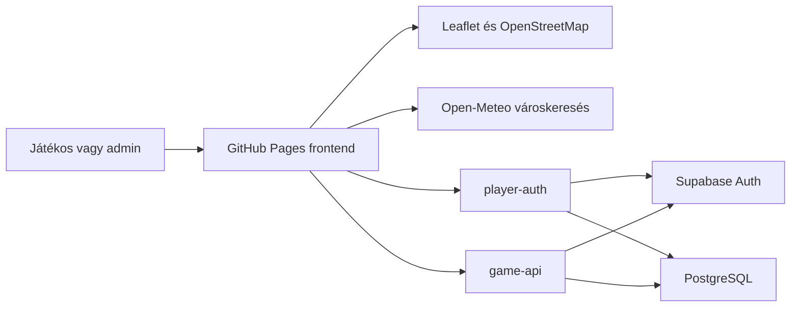
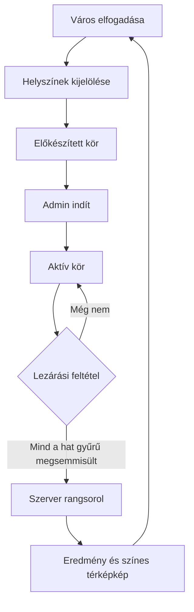
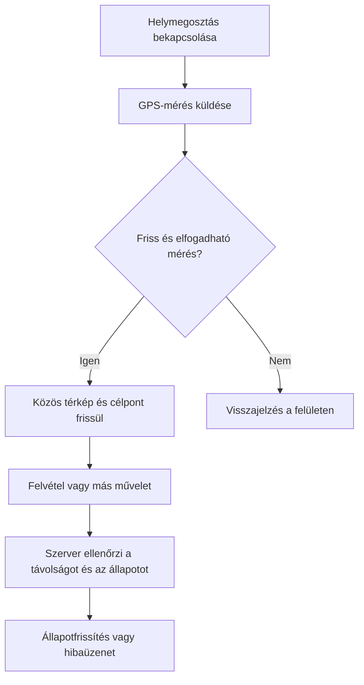
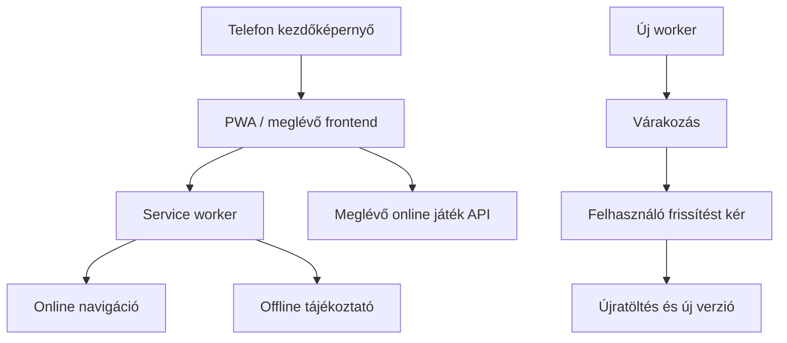
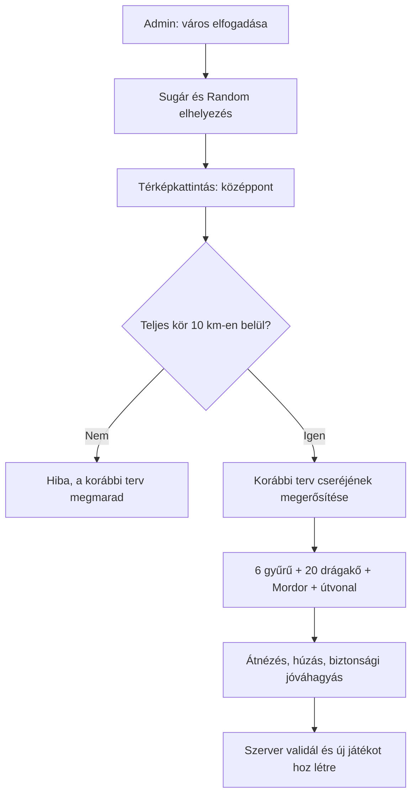
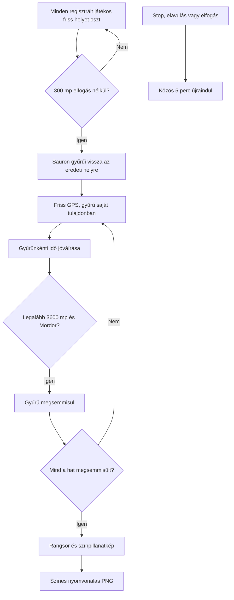
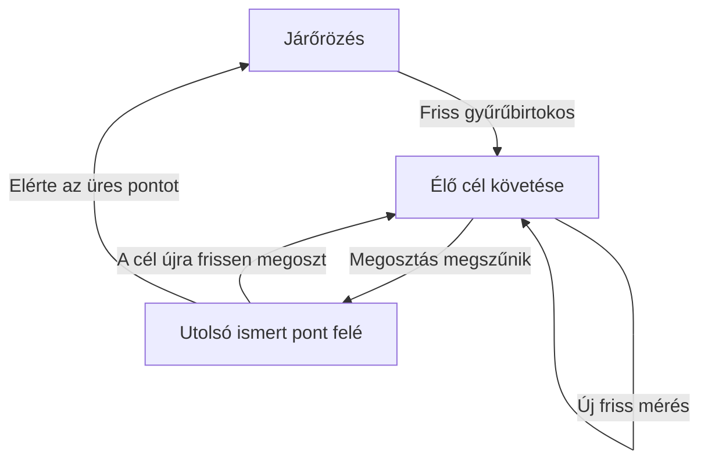

# Tervdokumentum

## Tartalomjegyzék

- [Közös visszaszerzés értesítései](#közös-visszaszerzés-értesítései)

- [Üldözési emlékezet és részletes szabálykönyv](#üldözési-emlékezet-és-részletes-szabálykönyv)

- [Sauron aktuális helyének láthatósága](#sauron-aktuális-helyének-láthatósága)

- [Adminisztrátori kézi leállítás](#adminisztrátori-kézi-leállítás)

- [Aktuális webes és natív állapot](#aktuális-webes-és-natív-állapot)
- [Belépés utáni összesítő javítása](#belépés-utáni-összesítő-javítása)
- [Natív alkalmazás és tartós rablásjelzés](#natív-alkalmazás-és-tartós-rablásjelzés)
- [Gyűrűidők, színek, megosztási nyomvonal és kiszabadítás](#gyűrűidők,-színek,-megosztási-nyomvonal-és-kiszabadítás)
- [Helyszínalapú random pálya](#helyszínalapú-random-pálya)
- [Megjelenítés és véletlen pályaterv](#megjelenítés-és-véletlen-pályaterv)
- [Mobilalkalmazás és gyorsítótár](#mobilalkalmazás-és-gyorsítótár)
- [Verziókövetés](#verziókövetés)
- [Architektúra](#architektúra)
- [Komponensek](#komponensek)
- [Alkalmazások, külső szolgáltatások és technológiák](#alkalmazások-külső-szolgáltatások-és-technológiák)
- [Folyamatábrák](#folyamatábrák)
- [Állapot és ellenőrzés](#állapot-és-ellenőrzés)

## Verziókövetés

| Dokumentum | Játékverzió | Dátum | Változás |
| --- | --- | --- | --- |
| 1.0 | 1.5.3 | 2026-11-16 | Első kiadás a jelenlegi játékhoz. |
| 1.1 | 1.5.3 | 2026-11-16 | Ellenőrizve a mobilos és asztali kézikönyv frissítésekor. |
| 1.2 | 1.5.3 | 2026-11-16 | Futtatási függőségek, technológiák és fejlesztőeszközök dokumentálása. |
| 1.3 | 1.5.3 | 2026-11-16 | Áttekintve a regressziós jegyzőkönyvezés bevezetésekor. |
| 1.4 | 1.6.0 | 2026-11-20 | Telepíthető mobilváltozat, használat, működés és korlátok dokumentálása. |
| 1.5 | 1.7.0 | 2026-11-20 | Belépett menü, világos/sötét megjelenítés és véletlen pályaterv. |
| 1.6 | 1.7.1 | 2026-11-20 | 1/3/5 km választó; gyűrűk és Mordor éttermeknél, kocsmáknál vagy nevezetességeknél. |
| 1.7 | 1.8.0 | 2026-11-21 | Gyűrűnkénti 60 perc, hat gyűrűs lezárás, színek, ikonbeállítás és körkép. |
| 1.8 | 1.8.0 | 2026-11-21 | Közös ötperces helymegosztás kiszabadítja Sauron gyűrűit. |
| 1.9 | 1.8.0 | 2026-11-21 | Telefonos sáv a Beállításokban és a térképoldal alján. |
| 1.10 | 1.8.0 | 2026-11-21 | Teljes szélességű, nagy helymegosztási gombok. |
| 1.11 | 1.8.0 | 2026-11-21 | Android/iPhone natív háttér-GPS igény rögzítve; a PWA korlátja változatlan, külön fejlesztés indul. |
| 1.12 | 1.9.0 | 2026-11-21 | Tartós, nyugtázható piros rablásjelzés és címzettvédett Realtime. |
| 1.13 | 1.9.0 | 2026-11-21 | Android/iPhone natív projektek, háttér-GPS és biztonságos munkamenethíd. |
| 1.14 | 1.9.1 | 2026-11-21 | Natív appkészítés elhalasztva, kód és eredmények megőrizve; automatikus fordítás kikapcsolva. |
| 1.15 | 1.9.1 | 2026-11-21 | Böngészős automatikus megosztásfolytatás kérése visszavonva; marad a kézi újraindítás. |
| 1.16 | 1.9.2 | 2026-11-21 | A felhasználó jóváhagyta a natív app folytatását; böngészős kézi GPS működés megmarad. |
| 1.17 | 1.9.3 | 2026-11-21 | Történeti popup tiltása belépéskor, körhöz kötött térkép; natív sikeres build és korlátok ellenőrizve. |
| 1.18 | 1.9.4 | 2026-11-21 | Admin kézi megszakítás visszaállítva, jogosultság és megerősítés tesztelve; az 1.9.3 élesítése igazolt. |
| 1.19 | 1.9.5 | 2026-11-21 | Sauron élő helye csak saját gyűrűvel és friss saját helymegosztással látható; szerverválasz és kliens ellenőrizve. |
| 1.20 | 1.9.6 | 2026-11-21 | Utolsó észlelési pontig tartó üldözés; játékbeli és Markdown szabálykönyv részletesítve. |
| 1.21 | 1.9.6 | 2026-11-21 | Közös kiszabadítás előtt minden földi gyűrűt be kell gyűjteni; számláló, felület és szabályok frissítve. |
| 1.22 | 1.9.7 | 2026-11-21 | Indulási és sikeres visszaszerzési popup minden játékosnak; bezárásuk nem állítja le a megosztást. |

## Architektúra

## Komponensek

| Komponens | Feladat |
| --- | --- |
| [index.html](../index.html), [style.css](../style.css) | Felület, térkép, kezelőpanelek, eredményablak |
| [script.js](../script.js) | Navigáció, munkamenet, GPS, időzítő, térképrétegek, állapotfrissítés |
| [map-model.js](../map-model.js) | Sauron nézete és karakterikonok |
| [placement-model.js](../placement-model.js) | Név szerinti gyűrűhelyek és a helyi terv |
| [player-auth](../supabase/functions/player-auth/index.ts) | Regisztráció, PIN-ellenőrzés, munkamenet létrehozása |
| [game-api](../supabase/functions/game-api/index.ts) | Hitelesített kérés továbbítása a játékfüggvényhez |
| [round-rules.sql](../database/round-rules.sql) | Az aktuális játékműveletek, üldözés, körlezárás |
| PostgreSQL | Játékosok, körök, tárgyak, utolsó helyek, rablások, pontok és események |

A felület publikus kulcsot használ, a kiszolgálókulcs csak a szerveren van. A közvetlen kliensadatbázis-hozzáférés korlátozott. A játékműveletek szerveroldalon ellenőrzik a munkamenetet, a jogosultságot és a kör állapotát. A tranzakciós zárolás sorba rendezi a versengő műveleteket.

## Alkalmazások, külső szolgáltatások és technológiák

### Éles szolgáltatások és külső adatforrások

| Alkalmazás vagy szolgáltatás | Szerepe | Mi történik, ha nem érhető el? |
| --- | --- | --- |
| GitHub, GitHub Pages és GitHub Actions | A repó tárolja a forrást. A Pages szolgálja ki a statikus oldalt. Az Actions felületén követhető a publikálás eredménye. | A Pages elérhetetlensége az oldal betöltését, a publikálási hiba az új verzió megjelenését érinti. |
| Supabase Auth, Edge Functions és PostgreSQL | Hitelesítés, a `player-auth` és `game-api` végpont futtatása, közös játékállapot és eredmények tárolása. | A belépés és a szerveroldali játékműveletek kieshetnek. |
| OpenStreetMap | A térképháttér raszteres csempéi. A játékos- és tárgyjelölőket a böngésző rajzolja a háttér fölé. | A térképháttér hiányozhat. A tárgyjelölők a háttér nélkül is megjelenhetnek, de a helyszínek ellenőrzéséhez a háttértérkép betöltése szükséges. |
| Open-Meteo Geocoding API, GeoNames adatokkal | Az admin által beírt település keresése és a városközpont koordinátáinak kitöltése. Gárdonyhoz beépített koordináták vannak. | Az API-t igénylő városkeresés nem működik. |

### Fejlesztési technológiák és könyvtárak

| Réteg | Használt technológia |
| --- | --- |
| Webes felület | HTML5, reszponzív CSS, natív JavaScript, DOM és Fetch API. A fájlok közvetlenül futnak a böngészőben, külön frontend buildlépés nélkül. |
| Térkép | Leaflet **1.9.4**, a repó `vendor/` könyvtárába csomagolva. Csempék, jelölők, körök és szerkeszthető pontok kezelésére szolgál. |
| Helymeghatározás és helyi adatok | Böngészős Geolocation API, `sessionStorage` a munkamenethez és `localStorage` az admin tervéhez. |
| Szerver | TypeScript a Supabase Deno futtatókörnyezetében. Az Edge Functionök HTTP-n érik el az Auth és a PostgreSQL-függvényeket kiszolgáló REST API-t. |
| Adatbázis | PostgreSQL, SQL és PL/pgSQL. A szabályok adatbázis-függvényekben futnak. A jogosultságokhoz RLS és szerepkörök, a PIN tárolásához a `pgcrypto` bővítmény bcrypt-függvényei tartoznak. |
| Dokumentáció | Markdown és Mermaid az architektúra és a folyamatábrák leírásához. |

### Fejlesztéshez és ellenőrzéshez használt eszközök

- **Codex** a fejlesztési és dokumentációs munkához, a csatlakoztatott **GitHub** és **Supabase** eszközökkel a forrás, a telepítés és az adatbázis ellenőrzéséhez.
- **Node.js és Node REPL** a JavaScript-ellenőrzésekhez. A `tests/*.test.cjs` fájlok a Node beépített moduljait használják.
- **Beépített böngésző** az éles felület ellenőrzéséhez, valamint **SQL-tesztek** a játékszabályok próbájához visszavonható tranzakcióban.
- **Képgenerálás** a kézikönyv sematikus illusztrációihoz és a különálló fantáziatérkép-koncepcióhoz. Ez a fejlesztési és dokumentációs munkához tartozik.

## Folyamatábrák

**Kör életciklusa**

**GPS és játékművelet**

## Állapot és ellenőrzés

A kliens nagyjából tíz másodpercenként kér közös állapotot. A GPS-méréseket aktív megosztásnál küldi, az elavult pozíciók kiesnek. Sauron mozgását a szerver a kéréseknél számolja. A város és a következő kör vázlata böngészőben tárolódik. Az éles játékállapot és a lezárt eredmények az adatbázisban maradnak. Telepítés után az [ellenőrzési napló](ELLENORZES.md) alapján kell célzott próbát végezni.

## Mobilalkalmazás és gyorsítótár

Új technológiák: Web App Manifest, Service Worker API, Cache Storage API, beforeinstallprompt és display-mode. Nincs új külső csomag vagy fizetős fejlesztőeszköz. A manifest a repó alkönyvtárához viszonyított scope/start_url értékeket használ. A pwa.js kezeli a telepítést, kapcsolatjelzést és a felhasználó által jóváhagyott frissítést. A sw.js csak tételesen felsorolt nyilvános statikus fájlokat tárol verziózott, alkalmazásnévvel elkülönített tárban. Navigáció: hálózat, hibánál offline.html. Nincs offline index vagy játékállapot. Külső szolgáltatás, térképcsempe, API, POST, token és helyadat nincs gyorsítótárazva. Új worker várakozik, csak frissítési jóváhagyásra aktiválódik; más alkalmazások tárát nem törli. A PNG ikonok saját geometrikus arany gyűrűt ábrázolnak zöld alapon. HTTPS szükséges.

Források: [Service worker](https://developer.mozilla.org/en-US/docs/Web/API/Service_Worker_API/Using_Service_Workers), [PWA telepítés](https://web.dev/learn/pwa/installation).

## Megjelenítés és véletlen pályaterv

Új komponens: appearance.js. A fejléc és menü láthatóságát a script.js accountView függvénye a szerver me objektumából és az aktuális kliensmunkamenetből állítja. A név textContent, az admin felület nem helyettesíti a szerver adminellenőrzését. Kilépéskor az admin szerkesztő bezárul. A témához CSS-változók és data-theme attribútum tartozik; localStorage kulcs karakterazonosítónként. Nem szinkronizált szerveres profilbeállítás. A térképszolgáltató eredeti térképcsempéi világosak maradnak, a kezelőfelület és a térképi felugró ablakok sötétíthetők.

PlacementModel.randomDraft: a gyűrűk és Mordor hét különböző, szűrt OSM-helyszínre kerülnek; a 20 drágakő gömbi célpontképlettel, terület szerint egyenletes sqrt(random) sugárral helyeződik el. 26 tárgyhely és külön Mordor; 8 szög szerint rendezett útvonalpont és zárópont. A route geometrikus vonallánc, nem úthálózatra illesztett útvonal. A kliens a kör teljes befoglalását ellenőrzi a város 10 km-es területén, a szerver minden koordinátát ismét validál. A terv helyileg mentett, a generált drágakövek, Mordor és útvonalpontok is húzhatók. A generálás vagy helymódosítás törli a draft biztonsági jóváhagyását.

public.game_action create: opcionális gem_count 20 vagy 40, hiányában 40. A konfiguráció tárolja a darabszámot; a létrehozás 6+gem_count tárgyat szúr be. A korábbi admin-, munkamenet-, pont- és safetyellenőrzések, valamint a service_role-only RPC-jogosultság megmaradnak. Telepítési SQL: database/random-placement.sql, a database/round-rules.sql ugyanezt a végső függvényt tartalmazza. Új külső könyvtár vagy szolgáltatás nincs.

## Helyszínalapú random pálya

Új komponens: poi-model.js. Új külső szolgáltatás: OpenStreetMap-adatokat kiszolgáló, ingyenes Overpass / Private.coffee, HTTPS GET, API-kulcs nélkül. Végpont: https://overpass.private.coffee/api/interpreter. CSP connect-src csak ezt a kipróbált Overpass-domaint engedi. A korábban próbált overpass-api.de nem része a végső konfigurációnak. Csak admin kezdeményez keresést, középpont+sugár szerint, 45 másodperces kliensidőkorláttal és 10 perces memóriabeli cache-sel. Sem POI-lekérdezés, sem helyadat nem kerül a service worker tárába. Egyszerre egy keresés fut; szerkesztőváltás, kilépés vagy városváltás elavult eredményét a kérésazonosító kiszűri.

Típusok: amenity=restaurant/pub/bar; tourism=attraction/museum/viewpoint; historic=castle/monument/memorial/ruins. Kizárva: access=private/no, disused=yes, abandoned=yes, körön kívüli vagy hibás koordináta, 30 m-en belüli duplikátum. Node koordináta, way/relation esetén OSM-középpont. Fisher–Yates választás hét különböző helyből; első hat gyűrű, hetedik Mordor. A helyek neve a szerkesztőben szövegként jelenik meg, HTML-ként nem értelmezzük. A kiválasztott hét POI a helyi draft poi_sites mezőjében megmarad. A generált gyűrű/Mordor áthelyezéskor 150 m-en belüli ismert POI-ra illeszkedik; egyébként visszautasított. Az aktív játék kézi admin-áthelyezése továbbra is a meglévő szerveres művelet.

A helyszín típusa OSM-adat, nem a nyitvatartás vagy biztonság igazolása. A way középpontja épület belsejébe eshet; a legális megközelítést az admin ellenőrzi. Forrás és licenc: [OpenStreetMap](https://www.openstreetmap.org/copyright), [Overpass szolgáltatók](https://wiki.openstreetmap.org/wiki/Overpass_API). A hét hely kiválasztását valódi, 56 elemes gárdonyi válasszal ellenőriztük; szűrés után 46 hely maradt.

## Gyűrűidők, színek, megosztási nyomvonal és kiszabadítás

Új komponensek: player-rules.js (8 szín, gyűrű- és kiszabadítási kijelzés), summary-map.js (Web Mercator, szegmensek, Canvas 2D, PNG-adat URL), assets/ring.svg. Nincs új csomag vagy fizetős szolgáltatás. A térképkép csak az aktuálisan megjelenített térképkivágás OSM-csempéit tölti be HTTPS-en, szokásos böngészőcache-sel; látható forrásmegjelölést tartalmaz. Sikertelen csempénél hiányos háttérre figyelmeztet, újrapróbálható. Nem hoz létre offline csempetárat.

Adatmodell: players.color_id smallint NOT NULL, 1–8 CHECK és UNIQUE index. BEFORE INSERT trigger tranzakciós zárral szabad színt sorsol, a meglévő hat játékos egyszeri egyedi színt kapott. game_action color csak nem aktív körben enged változtatást, a szerver kizárja az elfoglalt értéket. A profile művelet kezeli továbbra is az ikont; a form a Beállításokban van.

items.ring_share_seconds integer 0–3600, csak a saját tárgy időértéke kerül a kliensválaszba. location művelet két friss, 30 másodpercnél közelebbi megosztás között számol, az aktuális collected_at időponttal levágva a felvétel előtti részt. Egész másodperceket jóváír, maximum 3600-ig; hosszabb szünet, state-poll és önmagában eltelt falióra nem ad időt. Tulajdonosváltó műveletek és Sauron elfogása nulláznak. A destroy/destroy_all egy tranzakcióban ellenőrzi mindegyik érintett gyűrű jogosultságát. A bevezetés előtt nem igazolt időt nem pótoltuk; az élesítés előtti kör előkészített volt, senkinél nem volt gyűrű.

Privát location_samples tábla: game_id, player_id, lat/lng, sampled_at, segment_id. Aktív location kérésből készül minta az első mérésnél, szegmensváltáskor, legalább 30 másodperc után vagy legalább 10 másodperc és 25 m elmozdulás után. Stop és 30 másodperces frissességi hiány megszakítja a szegmenst; kikapcsolt megosztásból nincs új minta. RLS és közvetlen kliensjogok hiánya védi. Aktív körben a privát történet nem kerül a klienshez; lezárt körnél a hitelesített játékosok explicit round_map kérés válaszában kapják meg; a last_round csak az összesítő adatait hordozza. 30 napnál régebbi minta nem szerepel a válaszban, és a következő hitelesített játékkérés törli. Ez kérésvezérelt megőrzés, nem időzített cron.

A lezárás config.summary_players mezőben rögzíti a neveket, ikonokat és színeket. A round_map a pontokat játékosonként kb. 1200 pontra ritkítja, a szegmensvégeket megőrzi. A későbbi színváltás nem színezi át a lezárt kört. A PNG a böngészőben készül, nem kerül nyilvános tárhelyre; kilépéskor a képi hivatkozások és az összesítő állapota törlődnek. Korábbi körökhöz nem gyártunk utólagos helyadatot.

A kiszabadítás authoritative config mezői: rescue_started_at, rescue_checked_at, rescue_last_capture_at, rescue_completed_at, rescue_released. Az összes registration_completed játékos friss, pontos helye szükséges, nem csak a gyűrűbirtokosoké. Sauron elfogása és a stop azonnal resetel; a location régi frissessége és az ellenőrzésben 30 másodperces hiány is resetel. Sikeres 300 másodperc után a sauron állapotú gyűrűk ground állapotot kapnak, tulajdonos és idő törlődik, a ring_custody kiürül, sauron_release audit keletkezik. Az items latitude/longitude az eredeti földi helyet őrzi, így nincs új véletlen hely választás. A kör továbbra is aktív.

Telepítés: új projektnél az 1.7-es séma után database/ring-progress-colors.sql; a már feltelepített első 1.8-változathoz database/team-rescue.sql frissíti ugyanazt a játékfüggvényt. A round-rules.sql a végső játékfüggvény, az új oszlopok és helper-függvények nélkül önmagában nem telepíthető. Edge Function-változás nincs.

A lezárt képernyős, bezárt oldalas folyamatos GPS Androidon és iPhone-on külön natív alkalmazást igényel. Az 1.8.0 webes változat ezt nem teljesíti, nem címkéz elavult helyadatot frissként. Források: [Android háttérhelymeghatározás](https://developer.android.com/develop/sensors-and-location/location/background), [Apple Core Location](https://developer.apple.com/documentation/corelocation/handling-location-updates-in-the-background).

## Natív alkalmazás és tartós rablásjelzés

Új futtatási függőség: helyben csomagolt @supabase/supabase-js 2.119.2 UMD, MIT licenc, vendor/SUPABASE-LICENSE. Csak Realtime-feliratkozásra használjuk, auth-persist és SDK-s automatikus tokenfrissítés kikapcsolt; a meglévő ellenőrzött sessiont használja. A CSP az adott Supabase-projekt wss címét engedi, frame-src none. A hagyományos játéktáblákhoz továbbra sincs klienshozzáférés.

Új public.player_notices tábla, csak címzetti SELECT-engedéllyel. RLS a címzett auth.uid() értékét és az élő session_id-t ellenőrzi a can_read_game_notice boolean helperrel. A helper nem ad vissza felhasználói adatot és anon nem futtathatja. Sikeres rob tranzakció a tárgy nevét és rabló karakternevét a sértettnek menti. ack_notice csak a címzett saját rekordját írhatja. INSERT esemény Realtime, a nyugtázatlan lista a game_action válaszban is megmarad. A doboz önálló, nincs automatikus timer; renderNotices új jelzéskor térképre visz, Rendben szerveres nyugtázásig megmarad.

Natív platformok: Android Java + LocationManager, location típusú foreground service és értesítés, Android Keystore AES-GCM; iOS Swift + UIKit/WKWebView + Core Location background mode + Keychain AfterFirstUnlockThisDeviceOnly. Nincs fizetős natív SDK. A native-bridge.js csak az app saját natív felületét észleli; normál böngészőben nem aktív. A natív host kizárólag a saját HTTPS-játékoldalon enged HTTP- és helymegosztási kérést, pontos végpont-engedélylistával. A háttér-GPS nem JavaScript-timerre épül, és a natív HTTP-sor kezeli a tokenforgatást. Nyers szolgáltatási kulcs nincs az appban. A natív és UI HTTP ugyanazon tokenállományt használja, a későbbi webes refresh a friss natív refresh_tokenből indul.

A háttér location data.background=true kérés csak kisméretű ok/server_time választ kap. A kör végi térképadat külön round_map művelettel egyszer töltődik be; nem kerül bele minden tízmásodperces válaszba. A nyomvonal a privát sémában marad, csak hitelesített kérésre készül a lezárt kör képi alapja.

Fordítás: Android Gradle Plugin 8.13.0, Gradle 8.13, JDK 17, compile/target SDK 36, min SDK 26. iOS Xcode-projekt, Swift 5 mód, iOS 16 minimum. A GitHub Actions Android debug APK-t és aláíratlan iOS-szimulátorappot készít; valódi iPhone-aláírás és App Store-terjesztés nincs automatizálva. A saját gépen nincs Xcode/JDK/Android SDK, a natív fordítás ezért CI-feladat. Forrás: [Android foreground service](https://developer.android.com/develop/background-work/services/fgs/service-types#location), [Apple háttérhely](https://developer.apple.com/documentation/corelocation/handling-location-updates-in-the-background), [Supabase Realtime](https://supabase.com/docs/guides/realtime/postgres-changes).

## Aktuális webes és natív állapot

Az Android/iPhone fejlesztés a felhasználó jóváhagyása alapján folytatódott. A korábbi halasztás történeti döntés, nem jelenlegi korlátozás. Az Android 1.9.2 teszt-APK és az aláírás nélküli iOS-szimulátor build sikeres a [44842967106 futásban](https://github.com/ngynrbrt-prog/szuper-titkos-szovetseg/actions/runs/44842967106), forrás: `2dded917eb8561da9c27195eb1c7cbda439c2fdc`. Android build és lint sikeres; az első futás hibáját az AndroidX OnBackPressedDispatcher javította. [Android ZIP](https://github.com/ngynrbrt-prog/szuper-titkos-szovetseg/actions/runs/44842967106/artifacts/14681647800): kicsomagolás után az app-debug.apk telepíthető tesztelésre. Fizikai telefonos háttér-GPS még nem igazolt. Az iPhone valódi készülékes telepítéséhez aláírás szükséges; a felhasználónak nincs Apple-fejlesztői hozzáférése, aláírt iPhone-telepítő nincs.

A böngésző/PWA továbbra is használható; a natív híd normál böngészőben nem aktiválódik. Böngészős szünet után kézi helymegosztás-indítás szükséges, automatikus újraindítást a felhasználó nem kért. A szünet alatt nincs gyűrűidő-jóváírás.

## Belépés utáni összesítő javítása

Az 1.9.3 nem nyitja meg belépéskor egy korábban befejezett játék eredményablakát és térképét. Az aktív Gárdony-játék mellé így nem kerül a régi prágai kör képe. Az összesítő csak a bejelentkezve megfigyelt aktív kör befejezésekor jelenik meg, ugyanannak a körnek az azonosítójával és térképével. Ismételt állapotlekérés nem nyitja újra. Kijelentkezés törli a kliens körfigyelését; az adatbázis és a régi eredmények megmaradnak.

Automatizált ellenőrzés: 13 sikeres JavaScript-tesztcsomag, köztük a belépés, Gárdony/Prága eltérés, ismétlés, kijelentkezés és gyors új játék esetei. [Jegyzőkönyv](tesztjegyzokonyvek/2026-11-21-popup-1.9.3.md).

## Adminisztrátori kézi leállítás

Aktív játékban az Admin → Aktuális játék résznél a **Játék kézi leállítása** gomb jelenik meg. Megerősítés után megszakítja a futó kört: nincs győzteshirdetés vagy kör végi győzelmi térkép, a szerver kikapcsolja a kör helymegosztásait és az ötperces közös számlálót. Az adatokat megőrzi, admin_cancel eseményt naplóz. Az admin ezután új játékot konfigurálhat. Előkészített játékban ugyanitt **Előkészület elvetése** látható. Lezárt körnél a gomb inaktív. A rendes győzelmi feltétel továbbra is mind a hat gyűrű megsemmisítése.

A game_action új abort művelete élő munkamenetet és adminjogot ellenőriz, valamint confirm=true és az aktuális game azonosítóját kéri. Másik körre elavult gombnyomás nem állíthat le játékot. A frontend megerősítés elutasításakor nem küld kérést. A korábbi finish művelet továbbra is csak előkészületet vet el. A restore_explicit_admin_manual_stop migráció csak a függvényt bővíti, a futó éles kört nem állítja le. [Tesztjegyzőkönyv](tesztjegyzokonyvek/2026-11-21-admin-leallitas-1.9.4.md).

## Sauron aktuális helyének láthatósága

Az 1.9.5-ben aktív játék alatt minden játékos csak akkor láthatja Sauron aktuális helyét, ha **saját birtokában van legalább egy gyűrű**, és **a saját helymegosztása aktív, 30 másodpercnél frissebb, legfeljebb 50 m pontatlanságú**. Más játékos gyűrűje vagy megosztása nem elegendő; adminjog nem ad kivételt. A feltételek megszűnésekor a következő állapotfrissítés elrejti Sauront. A rablás utáni rejtőzési időben jogosult játékosnak sem látható. A játék előtti, kétóránként váltakozó más kontinenses észlelés változatlan.

A game_action a válasz sauron mezőjét az adott kérőre ellenőrzi. A game.config válaszából mindenkinél kihagyja a sauron_position, sauron_tick_at és sauron_target belső mezőket; a szerveroldali üldözéshez az adatbázisban megmaradnak. A kliens nem következtet helyre a járőrútvonalból, rejtett állapotban nincs jelölő és a Sauron mutatása gomb tiltott. Az üldözési szabály továbbra is csak friss helyet megosztó gyűrűbirtokost céloz.

Migráció: sauron_visible_only_to_sharing_ring_owner; forrás: database/sauron-visibility.sql. [Tesztjegyzőkönyv](tesztjegyzokonyvek/2026-11-21-sauron-lathatosag-1.9.5.md).

## Üldözési emlékezet és részletes szabálykönyv

Az 1.9.6-ban Sauron a kiválasztott gyűrűbirtokos utolsó érvényes megosztott helyét megőrzi. Friss új mérés frissíti a célt. A megosztás leállításakor vagy elavulásakor nem fordul azonnal vissza, hanem eléri a megjegyzett pontot. Megszűnt megosztásból nincs elfogás. Ha a megjegyzett pont üres, az emlékezet törlődik, és a következő kiértékelés új célpontot keres, ennek hiányában a járőrútvonal felé mozog. Sebesség és kérésvezérelt időléptetés változatlan. Az új belső sauron_last_seen és sauron_pursuit_player mezők sem kerülnek a klienshez. Migráció: sauron_reaches_last_seen_location, forrás database/sauron-last-seen.sql.

A közös kiszabadítás csak akkor indulhat, ha nincs a földön felvehető gyűrű: a nem Sauronnál lévő, meg nem semmisített gyűrűk mind játékosok birtokában vannak. Ezután mind a regisztrált játékosok ötpercnyi egyidejű friss helymegosztása kell; a korábbi megosztási idő nem előleg. Földön maradó gyűrű megszakítja/nullázza az időt. A megsemmisített gyűrűk nem akadályok. Ha minden megmaradt gyűrű Sauronnál van, a gyűjtési feltétel teljesült, de a közös öt perc kötelező. A térképi kártya jelzi, hány gyűrűt kell még összegyűjteni. Migráció: rescue_requires_all_ground_rings_collected, forrás database/rescue-all-rings-collected.sql.

A játék Szabályok oldala és a [részletes szabálykönyv](SZABALYKONYV.md) 11 fejezetben, 30 bekezdésben tartalmazza a tényleges gyűrűfelvételt, az egyórás saját időt, a rablást, a megsemmisítést, Sauron láthatóságát, üldözését, elfogását, a visszaszerzést, a közös kiszabadítást és a pontozást. Fantáziaképességek díszítő jellegűek, nincs nem megvalósított képesség működőként feltüntetve. [Tesztjegyzőkönyv](tesztjegyzokonyvek/2026-11-21-sauron-emlekezet-1.9.6.md).

## Közös visszaszerzés értesítései

A közös ötperces visszaszerzés indulásakor minden játékos tájékoztató popupot kap: minden regisztrált játékos megoszt, és a gyűrűvisszaszerzés folyamatban van. Sikeres befejezéskor külön popup jelzi, hány gyűrű került vissza eredeti helyére. Mindkét ablak a Rendben, bezárás gombbal bezárható. Az értesítés bezárása nem változtat a helymegosztás állapotán: ha az aktív volt, aktív marad. Ha le akarod állítani, külön nyomd meg a térképen a Megosztás leállítása gombot. Az értesítések a szerverállapot frissítésekor jelennek meg, nem telefonos push üzenetek; ugyanazt a bezárt eseményt ugyanannál a játékosnál, ugyanabban a böngészőben nem ismételjük.

A rescue-notices.js a hitelesített állapotból a game.config.rescue_started_at és rescue_completed_at/rescue_released szervermezőket figyeli. Egyedi játékos/kör/eseménytípus/időbélyeg kulcs alapján sorba állítja az üzeneteket. A bezárás localStorage nyugtát ment, külön játékosra és böngészőre; nem hív stop vagy helymeghatározási API-t. Kijelentkezés lezárja a megjelenített ablakot és üríti a sort. A kör végi eredményablak után várakozó visszaszerzési értesítés külön megnyílhat. Nem került be új adatbázistábla vagy migráció. [Tesztjegyzőkönyv](tesztjegyzokonyvek/2026-11-21-visszaszerzes-popup-1.9.7.md).
