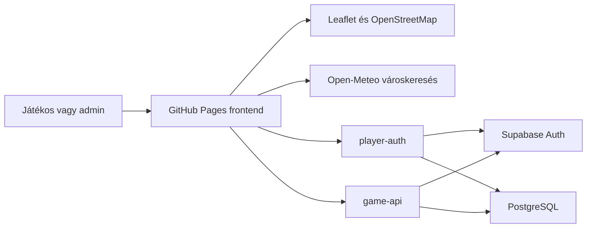
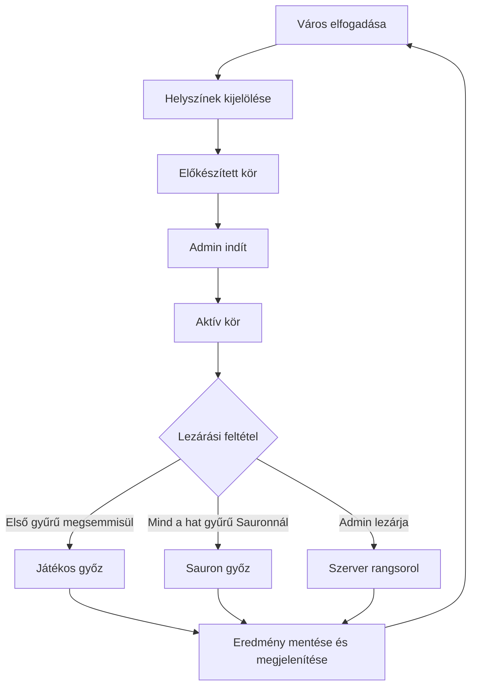
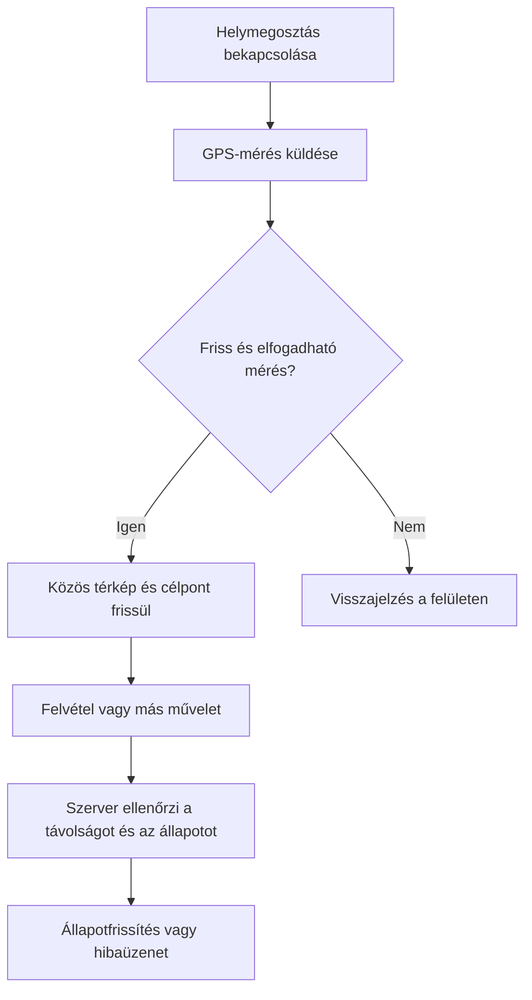
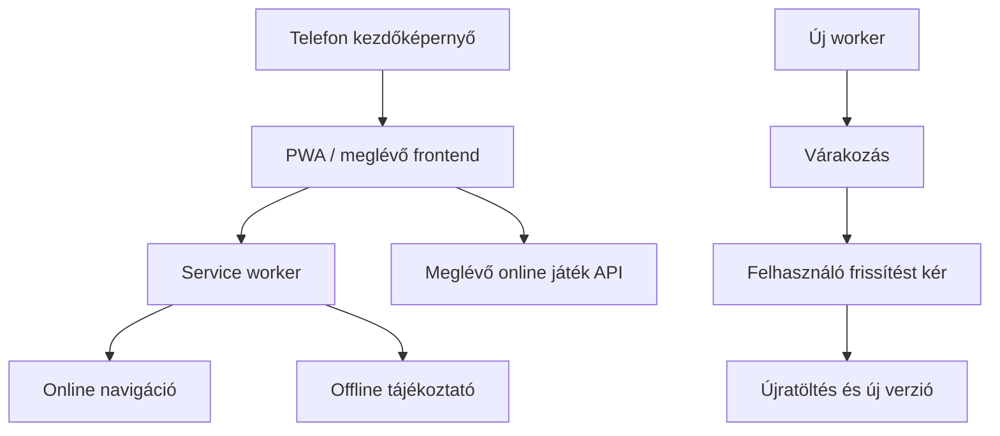

# Tervdokumentum

## Tartalomjegyzék

- [Mobilalkalmazás és gyorsítótár](#mobilalkalmazás-és-gyorsítótár)
- [Verziókövetés](#verziókövetés)
- [Architektúra](#architektúra)
- [Komponensek](#komponensek)
- [Alkalmazások, külső szolgáltatások és technológiák](#alkalmazások-külső-szolgáltatások-és-technológiák)
- [Folyamatábrák](#folyamatábrák)
- [Állapot és ellenőrzés](#állapot-és-ellenőrzés)

## Verziókövetés

| Dokumentum | Játékverzió | Dátum | Változás |
| --- | --- | --- | --- |
| 1.0 | 1.5.3 | 2026-11-16 | Első kiadás a jelenlegi játékhoz. |
| 1.1 | 1.5.3 | 2026-11-16 | Ellenőrizve a mobilos és asztali kézikönyv frissítésekor. |
| 1.2 | 1.5.3 | 2026-11-16 | Futtatási függőségek, technológiák és fejlesztőeszközök dokumentálása. |
| 1.3 | 1.5.3 | 2026-11-16 | Áttekintve a regressziós jegyzőkönyvezés bevezetésekor. |
| 1.4 | 1.6.0 | 2026-11-20 | Telepíthető mobilváltozat, használat, működés és korlátok dokumentálása. |

## Architektúra

## Komponensek

| Komponens | Feladat |
| --- | --- |
| [index.html](../index.html), [style.css](../style.css) | Felület, térkép, kezelőpanelek, eredményablak |
| [script.js](../script.js) | Navigáció, munkamenet, GPS, időzítő, térképrétegek, állapotfrissítés |
| [map-model.js](../map-model.js) | Sauron nézete és karakterikonok |
| [placement-model.js](../placement-model.js) | Név szerinti gyűrűhelyek és a helyi terv |
| [player-auth](../supabase/functions/player-auth/index.ts) | Regisztráció, PIN-ellenőrzés, munkamenet létrehozása |
| [game-api](../supabase/functions/game-api/index.ts) | Hitelesített kérés továbbítása a játékfüggvényhez |
| [round-rules.sql](../database/round-rules.sql) | Az aktuális játékműveletek, üldözés, körlezárás |
| PostgreSQL | Játékosok, körök, tárgyak, utolsó helyek, rablások, pontok és események |

A felület publikus kulcsot használ, a kiszolgálókulcs csak a szerveren van. A közvetlen kliensadatbázis-hozzáférés korlátozott. A játékműveletek szerveroldalon ellenőrzik a munkamenetet, a jogosultságot és a kör állapotát. A tranzakciós zárolás sorba rendezi a versengő műveleteket.

## Alkalmazások, külső szolgáltatások és technológiák

### Éles szolgáltatások és külső adatforrások

| Alkalmazás vagy szolgáltatás | Szerepe | Mi történik, ha nem érhető el? |
| --- | --- | --- |
| GitHub, GitHub Pages és GitHub Actions | A repó tárolja a forrást. A Pages szolgálja ki a statikus oldalt. Az Actions felületén követhető a publikálás eredménye. | A Pages elérhetetlensége az oldal betöltését, a publikálási hiba az új verzió megjelenését érinti. |
| Supabase Auth, Edge Functions és PostgreSQL | Hitelesítés, a `player-auth` és `game-api` végpont futtatása, közös játékállapot és eredmények tárolása. | A belépés és a szerveroldali játékműveletek kieshetnek. |
| OpenStreetMap | A térképháttér raszteres csempéi. A játékos- és tárgyjelölőket a böngésző rajzolja a háttér fölé. | A térképháttér hiányozhat. A tárgylista továbbra is elérhető, ha a játékszerver működik. |
| Open-Meteo Geocoding API, GeoNames adatokkal | Az admin által beírt település keresése és a városközpont koordinátáinak kitöltése. Gárdonyhoz beépített koordináták vannak. | Az API-t igénylő városkeresés nem működik. |

### Fejlesztési technológiák és könyvtárak

| Réteg | Használt technológia |
| --- | --- |
| Webes felület | HTML5, reszponzív CSS, natív JavaScript, DOM és Fetch API. A fájlok közvetlenül futnak a böngészőben, külön frontend buildlépés nélkül. |
| Térkép | Leaflet **1.9.4**, a repó `vendor/` könyvtárába csomagolva. Csempék, jelölők, körök és szerkeszthető pontok kezelésére szolgál. |
| Helymeghatározás és helyi adatok | Böngészős Geolocation API, `sessionStorage` a munkamenethez és `localStorage` az admin tervéhez. |
| Szerver | TypeScript a Supabase Deno futtatókörnyezetében. Az Edge Functionök HTTP-n érik el az Auth és a PostgreSQL-függvényeket kiszolgáló REST API-t. |
| Adatbázis | PostgreSQL, SQL és PL/pgSQL. A szabályok adatbázis-függvényekben futnak. A jogosultságokhoz RLS és szerepkörök, a PIN tárolásához a `pgcrypto` bővítmény bcrypt-függvényei tartoznak. |
| Dokumentáció | Markdown és Mermaid az architektúra és a folyamatábrák leírásához. |

### Fejlesztéshez és ellenőrzéshez használt eszközök

- **Codex** a fejlesztési és dokumentációs munkához, a csatlakoztatott **GitHub** és **Supabase** eszközökkel a forrás, a telepítés és az adatbázis ellenőrzéséhez.
- **Node.js és Node REPL** a JavaScript-ellenőrzésekhez. A `tests/*.test.cjs` fájlok a Node beépített moduljait használják.
- **Beépített böngésző** az éles felület ellenőrzéséhez, valamint **SQL-tesztek** a játékszabályok próbájához visszavonható tranzakcióban.
- **Képgenerálás** a kézikönyv sematikus illusztrációihoz és a különálló fantáziatérkép-koncepcióhoz. Ez a fejlesztési és dokumentációs munkához tartozik.

## Folyamatábrák

**Kör életciklusa**

**GPS és játékművelet**

## Állapot és ellenőrzés

A kliens nagyjából tíz másodpercenként kér közös állapotot. A GPS-méréseket aktív megosztásnál küldi, az elavult pozíciók kiesnek. Sauron mozgását a szerver a kéréseknél számolja. A város és a következő kör vázlata böngészőben tárolódik. Az éles játékállapot és a lezárt eredmények az adatbázisban maradnak. Telepítés után az [ellenőrzési napló](ELLENORZES.md) alapján kell célzott próbát végezni.

## Mobilalkalmazás és gyorsítótár

Új technológiák: Web App Manifest, Service Worker API, Cache Storage API, beforeinstallprompt és display-mode. Nincs új külső csomag vagy fizetős fejlesztőeszköz. A manifest a repó alkönyvtárához viszonyított scope/start_url értékeket használ. A pwa.js kezeli a telepítést, kapcsolatjelzést és a felhasználó által jóváhagyott frissítést. A sw.js csak tételesen felsorolt nyilvános statikus fájlokat tárol verziózott, alkalmazásnévvel elkülönített tárban. Navigáció: hálózat, hibánál offline.html. Nincs offline index vagy játékállapot. Külső szolgáltatás, térképcsempe, API, POST, token és helyadat nincs gyorsítótárazva. Új worker várakozik, csak frissítési jóváhagyásra aktiválódik; más alkalmazások tárát nem törli. A PNG ikonok saját geometrikus arany gyűrűt ábrázolnak zöld alapon. HTTPS szükséges.

Források: [Service worker](https://developer.mozilla.org/en-US/docs/Web/API/Service_Worker_API/Using_Service_Workers), [PWA telepítés](https://web.dev/learn/pwa/installation).
