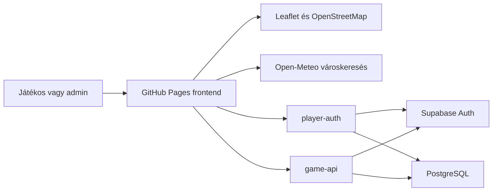
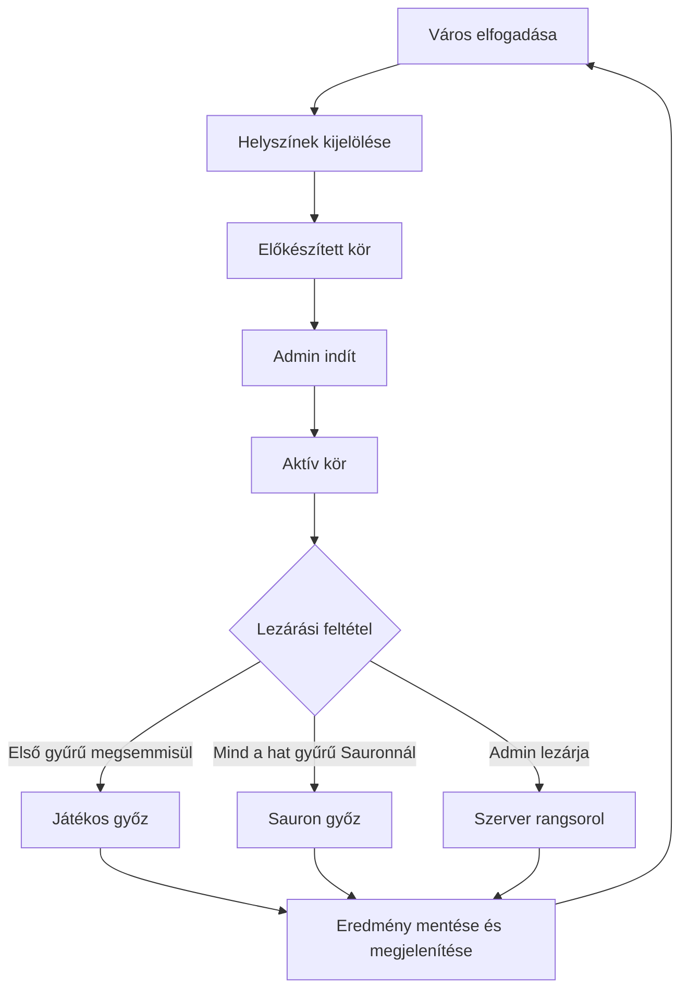
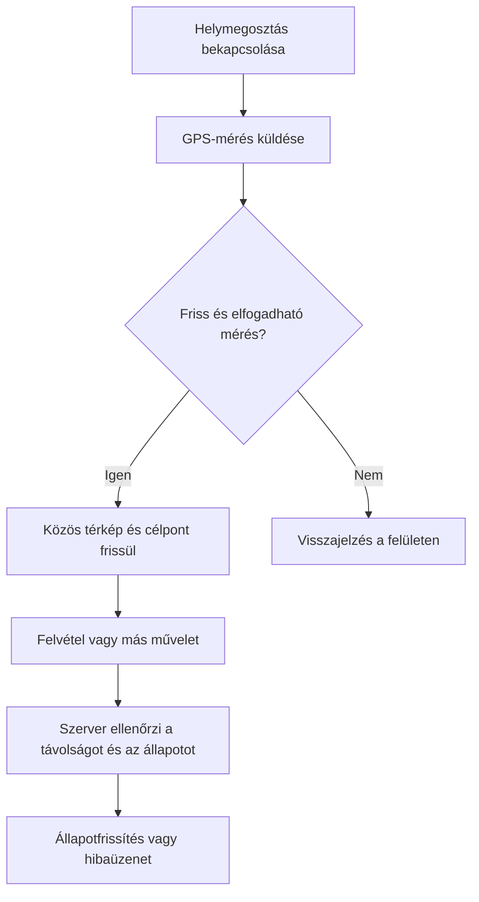
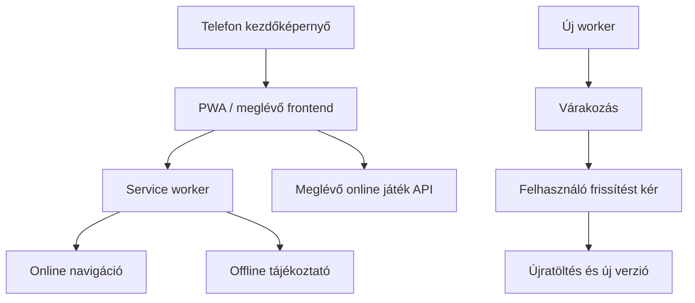
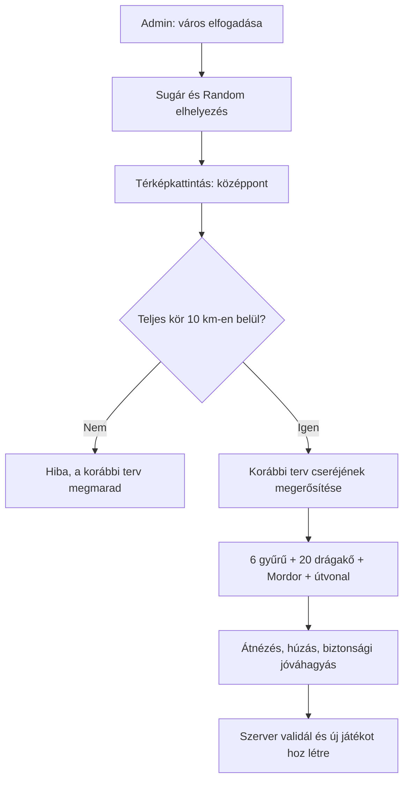

# Tervdokumentum

## Tartalomjegyzék

- [Helyszínalapú random pálya](#helyszínalapú-random-pálya)
- [Megjelenítés és véletlen pályaterv](#megjelenítés-és-véletlen-pályaterv)
- [Mobilalkalmazás és gyorsítótár](#mobilalkalmazás-és-gyorsítótár)
- [Verziókövetés](#verziókövetés)
- [Architektúra](#architektúra)
- [Komponensek](#komponensek)
- [Alkalmazások, külső szolgáltatások és technológiák](#alkalmazások-külső-szolgáltatások-és-technológiák)
- [Folyamatábrák](#folyamatábrák)
- [Állapot és ellenőrzés](#állapot-és-ellenőrzés)

## Verziókövetés

| Dokumentum | Játékverzió | Dátum | Változás |
| --- | --- | --- | --- |
| 1.0 | 1.5.3 | 2026-11-16 | Első kiadás a jelenlegi játékhoz. |
| 1.1 | 1.5.3 | 2026-11-16 | Ellenőrizve a mobilos és asztali kézikönyv frissítésekor. |
| 1.2 | 1.5.3 | 2026-11-16 | Futtatási függőségek, technológiák és fejlesztőeszközök dokumentálása. |
| 1.3 | 1.5.3 | 2026-11-16 | Áttekintve a regressziós jegyzőkönyvezés bevezetésekor. |
| 1.4 | 1.6.0 | 2026-11-20 | Telepíthető mobilváltozat, használat, működés és korlátok dokumentálása. |
| 1.5 | 1.7.0 | 2026-11-20 | Belépett menü, világos/sötét megjelenítés és véletlen pályaterv. |
| 1.6 | 1.7.1 | 2026-11-20 | 1/3/5 km választó; gyűrűk és Mordor éttermeknél, kocsmáknál vagy nevezetességeknél. |

## Architektúra

## Komponensek

| Komponens | Feladat |
| --- | --- |
| [index.html](../index.html), [style.css](../style.css) | Felület, térkép, kezelőpanelek, eredményablak |
| [script.js](../script.js) | Navigáció, munkamenet, GPS, időzítő, térképrétegek, állapotfrissítés |
| [map-model.js](../map-model.js) | Sauron nézete és karakterikonok |
| [placement-model.js](../placement-model.js) | Név szerinti gyűrűhelyek és a helyi terv |
| [player-auth](../supabase/functions/player-auth/index.ts) | Regisztráció, PIN-ellenőrzés, munkamenet létrehozása |
| [game-api](../supabase/functions/game-api/index.ts) | Hitelesített kérés továbbítása a játékfüggvényhez |
| [round-rules.sql](../database/round-rules.sql) | Az aktuális játékműveletek, üldözés, körlezárás |
| PostgreSQL | Játékosok, körök, tárgyak, utolsó helyek, rablások, pontok és események |

A felület publikus kulcsot használ, a kiszolgálókulcs csak a szerveren van. A közvetlen kliensadatbázis-hozzáférés korlátozott. A játékműveletek szerveroldalon ellenőrzik a munkamenetet, a jogosultságot és a kör állapotát. A tranzakciós zárolás sorba rendezi a versengő műveleteket.

## Alkalmazások, külső szolgáltatások és technológiák

### Éles szolgáltatások és külső adatforrások

| Alkalmazás vagy szolgáltatás | Szerepe | Mi történik, ha nem érhető el? |
| --- | --- | --- |
| GitHub, GitHub Pages és GitHub Actions | A repó tárolja a forrást. A Pages szolgálja ki a statikus oldalt. Az Actions felületén követhető a publikálás eredménye. | A Pages elérhetetlensége az oldal betöltését, a publikálási hiba az új verzió megjelenését érinti. |
| Supabase Auth, Edge Functions és PostgreSQL | Hitelesítés, a `player-auth` és `game-api` végpont futtatása, közös játékállapot és eredmények tárolása. | A belépés és a szerveroldali játékműveletek kieshetnek. |
| OpenStreetMap | A térképháttér raszteres csempéi. A játékos- és tárgyjelölőket a böngésző rajzolja a háttér fölé. | A térképháttér hiányozhat. A tárgyjelölők a háttér nélkül is megjelenhetnek, de a helyszínek ellenőrzéséhez a háttértérkép betöltése szükséges. |
| Open-Meteo Geocoding API, GeoNames adatokkal | Az admin által beírt település keresése és a városközpont koordinátáinak kitöltése. Gárdonyhoz beépített koordináták vannak. | Az API-t igénylő városkeresés nem működik. |

### Fejlesztési technológiák és könyvtárak

| Réteg | Használt technológia |
| --- | --- |
| Webes felület | HTML5, reszponzív CSS, natív JavaScript, DOM és Fetch API. A fájlok közvetlenül futnak a böngészőben, külön frontend buildlépés nélkül. |
| Térkép | Leaflet **1.9.4**, a repó `vendor/` könyvtárába csomagolva. Csempék, jelölők, körök és szerkeszthető pontok kezelésére szolgál. |
| Helymeghatározás és helyi adatok | Böngészős Geolocation API, `sessionStorage` a munkamenethez és `localStorage` az admin tervéhez. |
| Szerver | TypeScript a Supabase Deno futtatókörnyezetében. Az Edge Functionök HTTP-n érik el az Auth és a PostgreSQL-függvényeket kiszolgáló REST API-t. |
| Adatbázis | PostgreSQL, SQL és PL/pgSQL. A szabályok adatbázis-függvényekben futnak. A jogosultságokhoz RLS és szerepkörök, a PIN tárolásához a `pgcrypto` bővítmény bcrypt-függvényei tartoznak. |
| Dokumentáció | Markdown és Mermaid az architektúra és a folyamatábrák leírásához. |

### Fejlesztéshez és ellenőrzéshez használt eszközök

- **Codex** a fejlesztési és dokumentációs munkához, a csatlakoztatott **GitHub** és **Supabase** eszközökkel a forrás, a telepítés és az adatbázis ellenőrzéséhez.
- **Node.js és Node REPL** a JavaScript-ellenőrzésekhez. A `tests/*.test.cjs` fájlok a Node beépített moduljait használják.
- **Beépített böngésző** az éles felület ellenőrzéséhez, valamint **SQL-tesztek** a játékszabályok próbájához visszavonható tranzakcióban.
- **Képgenerálás** a kézikönyv sematikus illusztrációihoz és a különálló fantáziatérkép-koncepcióhoz. Ez a fejlesztési és dokumentációs munkához tartozik.

## Folyamatábrák

**Kör életciklusa**

**GPS és játékművelet**

## Állapot és ellenőrzés

A kliens nagyjából tíz másodpercenként kér közös állapotot. A GPS-méréseket aktív megosztásnál küldi, az elavult pozíciók kiesnek. Sauron mozgását a szerver a kéréseknél számolja. A város és a következő kör vázlata böngészőben tárolódik. Az éles játékállapot és a lezárt eredmények az adatbázisban maradnak. Telepítés után az [ellenőrzési napló](ELLENORZES.md) alapján kell célzott próbát végezni.

## Mobilalkalmazás és gyorsítótár

Új technológiák: Web App Manifest, Service Worker API, Cache Storage API, beforeinstallprompt és display-mode. Nincs új külső csomag vagy fizetős fejlesztőeszköz. A manifest a repó alkönyvtárához viszonyított scope/start_url értékeket használ. A pwa.js kezeli a telepítést, kapcsolatjelzést és a felhasználó által jóváhagyott frissítést. A sw.js csak tételesen felsorolt nyilvános statikus fájlokat tárol verziózott, alkalmazásnévvel elkülönített tárban. Navigáció: hálózat, hibánál offline.html. Nincs offline index vagy játékállapot. Külső szolgáltatás, térképcsempe, API, POST, token és helyadat nincs gyorsítótárazva. Új worker várakozik, csak frissítési jóváhagyásra aktiválódik; más alkalmazások tárát nem törli. A PNG ikonok saját geometrikus arany gyűrűt ábrázolnak zöld alapon. HTTPS szükséges.

Források: [Service worker](https://developer.mozilla.org/en-US/docs/Web/API/Service_Worker_API/Using_Service_Workers), [PWA telepítés](https://web.dev/learn/pwa/installation).

## Megjelenítés és véletlen pályaterv

Új komponens: appearance.js. A fejléc és menü láthatóságát a script.js accountView függvénye a szerver me objektumából és az aktuális kliensmunkamenetből állítja. A név textContent, az admin felület nem helyettesíti a szerver adminellenőrzését. Kilépéskor az admin szerkesztő bezárul. A témához CSS-változók és data-theme attribútum tartozik; localStorage kulcs karakterazonosítónként. Nem szinkronizált szerveres profilbeállítás. A térképszolgáltató eredeti térképcsempéi világosak maradnak, a kezelőfelület és a térképi felugró ablakok sötétíthetők.

PlacementModel.randomDraft: a gyűrűk és Mordor hét különböző, szűrt OSM-helyszínre kerülnek; a 20 drágakő gömbi célpontképlettel, terület szerint egyenletes sqrt(random) sugárral helyeződik el. 26 tárgyhely és külön Mordor; 8 szög szerint rendezett útvonalpont és zárópont. A route geometrikus vonallánc, nem úthálózatra illesztett útvonal. A kliens a kör teljes befoglalását ellenőrzi a város 10 km-es területén, a szerver minden koordinátát ismét validál. A terv helyileg mentett, a generált drágakövek, Mordor és útvonalpontok is húzhatók. A generálás vagy helymódosítás törli a draft biztonsági jóváhagyását.

public.game_action create: opcionális gem_count 20 vagy 40, hiányában 40. A konfiguráció tárolja a darabszámot; a létrehozás 6+gem_count tárgyat szúr be. A korábbi admin-, munkamenet-, pont- és safetyellenőrzések, valamint a service_role-only RPC-jogosultság megmaradnak. Telepítési SQL: database/random-placement.sql, a database/round-rules.sql ugyanezt a végső függvényt tartalmazza. Új külső könyvtár vagy szolgáltatás nincs.

## Helyszínalapú random pálya

Új komponens: poi-model.js. Új külső szolgáltatás: OpenStreetMap-adatokat kiszolgáló, ingyenes Overpass / Private.coffee, HTTPS GET, API-kulcs nélkül. Végpont: https://overpass.private.coffee/api/interpreter. CSP connect-src csak ezt a kipróbált Overpass-domaint engedi. A korábban próbált overpass-api.de nem része a végső konfigurációnak. Csak admin kezdeményez keresést, középpont+sugár szerint, 45 másodperces kliensidőkorláttal és 10 perces memóriabeli cache-sel. Sem POI-lekérdezés, sem helyadat nem kerül a service worker tárába. Egyszerre egy keresés fut; szerkesztőváltás, kilépés vagy városváltás elavult eredményét a kérésazonosító kiszűri.

Típusok: amenity=restaurant/pub/bar; tourism=attraction/museum/viewpoint; historic=castle/monument/memorial/ruins. Kizárva: access=private/no, disused=yes, abandoned=yes, körön kívüli vagy hibás koordináta, 30 m-en belüli duplikátum. Node koordináta, way/relation esetén OSM-középpont. Fisher–Yates választás hét különböző helyből; első hat gyűrű, hetedik Mordor. A helyek neve a szerkesztőben szövegként jelenik meg, HTML-ként nem értelmezzük. A kiválasztott hét POI a helyi draft poi_sites mezőjében megmarad. A generált gyűrű/Mordor áthelyezéskor 150 m-en belüli ismert POI-ra illeszkedik; egyébként visszautasított. Az aktív játék kézi admin-áthelyezése továbbra is a meglévő szerveres művelet.

A helyszín típusa OSM-adat, nem a nyitvatartás vagy biztonság igazolása. A way középpontja épület belsejébe eshet; a legális megközelítést az admin ellenőrzi. Forrás és licenc: [OpenStreetMap](https://www.openstreetmap.org/copyright), [Overpass szolgáltatók](https://wiki.openstreetmap.org/wiki/Overpass_API). A hét hely kiválasztását valódi, 56 elemes gárdonyi válasszal ellenőriztük; szűrés után 46 hely maradt.
